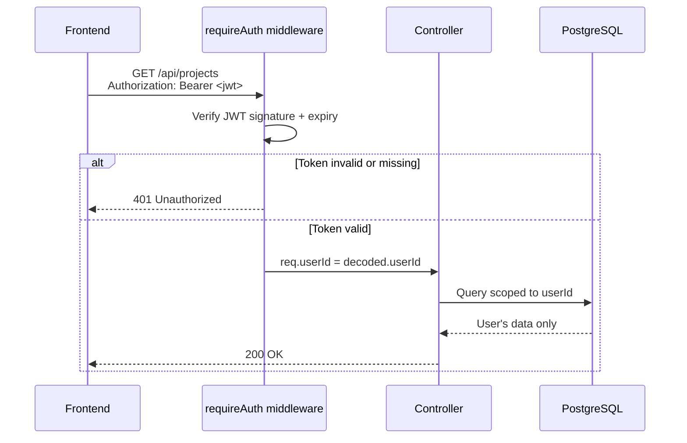
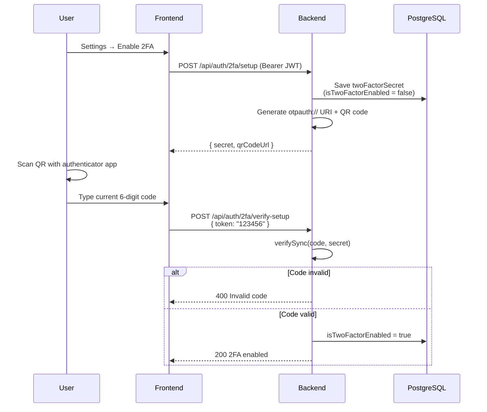

# Authentication & Security — Digital Logbook Backend

This document explains, in depth, how authentication and security work in the Digital Logbook API: what each piece does, why it was built that way, and where the known limitations are. It is written so that anyone reviewing the code (teammates, markers, or a security reviewer) can understand the system without tracing every file.

---

## Table of Contents

1. [The Big Picture](#the-big-picture)
2. [Key Files](#key-files)
3. [Core Authentication Flows](#core-authentication-flows)
   - [Registration & Email Verification](#1-registration--email-verification)
   - [Login (without 2FA)](#2-login-without-2fa)
   - [Password Reset](#3-password-reset)
   - [Account Deletion](#4-account-deletion)
4. [Two-Factor Authentication (TOTP)](#two-factor-authentication-totp)
   - [How TOTP Works in General](#how-totp-works-in-general)
   - [Enabling 2FA (Setup Flow)](#enabling-2fa-setup-flow)
   - [Logging in with 2FA](#logging-in-with-2fa)
   - [Disabling 2FA](#disabling-2fa)
5. [Database Schema & Migrations](#database-schema--migrations)
6. [Security Properties & Design Decisions](#security-properties--design-decisions)
7. [Known Limitations & Future Improvements](#known-limitations--future-improvements)
8. [Frequently Asked Questions](#frequently-asked-questions)

---

## The Big Picture

The Digital Logbook uses **JWT-based authentication with optional TOTP two-factor authentication**:

- **JWT (JSON Web Token)** — after a successful login, the server issues a signed token. The frontend sends it with every request in the `Authorization: Bearer <token>` header, and protected routes verify it before doing anything.
- **TOTP (Time-based One-Time Password)** — the 6-digit rotating codes generated by authenticator apps like Google Authenticator or Authy. This is an *optional, per-user* second factor: users who enable it must provide a current code in addition to their password.

**TOTP in one sentence:** during setup the server and the user's phone share a secret; both sides independently compute a code from *secret + current time window*, so the correct code can only be produced by someone holding the secret — and each code is only valid for ~30 seconds.

All of the auth logic is hand-written Express route handlers built on **established, battle-tested libraries** — `bcryptjs` for password hashing, `jsonwebtoken` for tokens, `otplib` for TOTP, and `nodemailer` for email delivery. No custom cryptography anywhere.

---

## Key Files

| File | Role |
|---|---|
| [`src/routes/auth.routes.ts`](src/routes/auth.routes.ts) | All authentication endpoints: register, login, 2FA setup/verify/disable, email verification, password reset, account deletion |
| [`src/utils/auth.ts`](src/utils/auth.ts) | Password hashing (`bcryptjs`, 10 salt rounds) and JWT sign/verify (7-day expiry) |
| [`src/middleware/auth.middleware.ts`](src/middleware/auth.middleware.ts) | `requireAuth` middleware — extracts and verifies the `Bearer` token on protected routes, attaches `req.userId` |
| [`packages/shared/src/auth.ts`](../../../packages/shared/src/auth.ts) | Zod validation schemas for every auth request body, shared between frontend and backend |
| [`src/utils/email.ts`](src/utils/email.ts) | Gmail SMTP helpers for verification and password-reset emails |
| [`prisma/schema.prisma`](prisma/schema.prisma) | The `User` and `PasswordReset` models — where auth data lives |

### Request lifecycle on a protected route



Because every protected query is scoped by the `userId` embedded in the (server-signed) JWT, one user can never read or modify another user's projects or entries.

---

## Core Authentication Flows

### 1. Registration & Email Verification

**`POST /api/auth/register`** with `{ fullName, email, password }`:

1. The request body is validated with the shared Zod schema (`registerSchema`). Invalid input returns `400` with per-field errors.
2. If the email already exists, the endpoint returns `409` — but the same "already exists" check also prevents duplicate accounts from being created.
3. The password is **never stored in plain text**. It is hashed with bcrypt (10 salt rounds) and only the `passwordHash` is saved.
4. A 32-byte random verification token (`crypto.randomBytes(32).toString("hex")`) is generated with a **1-hour expiry** and stored on the user record.
5. Email delivery has two modes:
   - **Production (SMTP configured):** a verification email containing a link (`/verify-email?token=...`) is sent via Gmail SMTP.
   - **Dev mode (no SMTP credentials):** the account is auto-verified and the link is logged to the server console — this keeps local development friction-free.

**`POST /api/auth/verify-email`** with `{ token }`:

- The server looks up a user whose `emailVerificationToken` matches **and** whose `emailVerificationExpiry` is still in the future. Expired or unknown tokens return `400`.
- On success the account is marked verified and the token is cleared.

**Login is blocked until verification completes** — an unverified user attempting to log in receives `403` with a clear message. This proves account ownership before granting access.

### 2. Login (without 2FA)

**`POST /api/auth/login`** with `{ email, password }`:

1. Validate the body with Zod.
2. Look up the user by email. If no user exists, return `401 Invalid email or password`.
3. Compare the submitted password against the stored hash with `bcrypt.compare`. Wrong password → `401`.
4. If the account is not email-verified → `403` (see above).
5. If 2FA is **enabled**, the response is **not** a token — see [Logging in with 2FA](#logging-in-with-2fa).
6. Otherwise, sign and return a JWT with a **7-day expiry**, along with the basic user profile.

> **Why the generic error message?** "Invalid email or password" deliberately does not reveal *which* of the two was wrong. Telling an attacker "that email isn't registered" vs. "wrong password" lets them enumerate which emails have accounts.

### 3. Password Reset

The reset flow is deliberately split into two endpoints so the secret (the token) travels only by email:

**`POST /api/auth/forgot-password`** with `{ email }`:

1. If no user exists with that email, the endpoint **still returns the same success message** — "If account exists, a password reset email has been sent." This prevents email enumeration: an attacker probing the endpoint learns nothing about which emails are registered.
2. For a real user, a fresh 32-byte random token is generated and stored in the `password_resets` table with a **1-hour expiry**.
3. A reset email containing the token as a link is sent via SMTP. A failure to send is logged server-side but does not leak information to the caller.

**`POST /api/auth/reset-password`** with `{ token, newPassword }`:

1. Find a reset record where the token matches and `expiresAt` is still in the future — otherwise `400 Invalid or expired password reset token`.
2. Hash the new password with bcrypt.
3. **Atomically**, in a single database transaction:
   - update the user's `passwordHash`, and
   - delete **all** of that user's reset tokens (single-use semantics — a token can never be replayed, and any outstanding tokens are invalidated the moment the password changes).

**`DELETE /api/auth/account`** with `{ confirmPassword }` (requires `Authorization: Bearer <jwt>`):

1. Verify the caller's current password against the stored hash. A stolen JWT alone is not enough to delete the account — this is a deliberate re-authentication step.
2. Delete the user row. Every foreign key in the schema uses `ON DELETE CASCADE`, so all projects, entries, field values, and reset tokens belonging to the user are permanently erased in the same operation — satisfying the "full account erasure" requirement.

---

## Two-Factor Authentication (TOTP)

2FA is **opt-in, per user**. The frontend checks `GET /api/auth/2fa/status` (a protected endpoint that simply returns `{ isTwoFactorEnabled }`) to know which UI to show.

### How TOTP Works in General

1. During setup, the server generates a random secret and shares it with the user exactly once (via QR code).
2. The user's authenticator app stores the secret alongside the issuer and account label.
3. From then on, both sides independently derive the same 6-digit code from `HMAC(secret, current_30s_time_window)`.
4. The server verifies a submitted code by recomputing it for the current time window. Correct code ⇒ the requester holds the secret.

The secret never leaves the user's phone again after setup, and codes expire within ~30 seconds, which is what makes stolen (or shoulder-surfed) codes nearly useless.

### Enabling 2FA (Setup Flow)

The setup is intentionally a **two-step process** — the factor is only activated after the user proves their authenticator is correctly configured:



**Step 1 — `POST /api/auth/2fa/setup`** (protected):

- Rejects the request if 2FA is already enabled.
- Generates a TOTP secret with `otplib`'s `generateSecret()`.
- Builds an `otpauth://` URI with issuer `"Digital Logbook"` and the user's email as the label — this is what makes the entry in the authenticator app say "Digital Logbook: user@wits.ac.za" instead of a bare secret.
- Renders that URI as a **QR code** (base64 data URL via the `qrcode` library) so the user can scan it instead of typing the secret by hand.
- Saves the secret **immediately**, but with `isTwoFactorEnabled: false` — the factor is *staged, not active*.

**Step 2 — `POST /api/auth/2fa/verify-setup`** (protected) with `{ token }`:

- Requires that a setup is in progress (a secret exists and 2FA isn't already on).
- Verifies the submitted 6-digit code against the staged secret with `verifySync`.
- Only on success does it flip `isTwoFactorEnabled: true`.

**Why the two steps?** If the server enabled 2FA at step 1 and the user's QR scan silently failed, the user would be locked out at their very next login. Requiring a successful code first guarantees the user's authenticator genuinely shares the secret before the factor becomes mandatory for them.

### Logging in with 2FA

With 2FA enabled, login becomes a two-request sequence:

**Step 1 — `POST /api/auth/login`** (email + password):

- Email, password, and email-verification checks all run exactly as in the normal flow.
- If they pass **but** `isTwoFactorEnabled` is true, the endpoint deliberately returns **no JWT**:
  ```json
  { "requiresTwoFactor": true, "email": "user@wits.ac.za" }
  ```
  The password check has succeeded — but possession of the second factor has not yet been demonstrated, so no session credential is issued.

**Step 2 — `POST /api/auth/login/2fa`** (email + 6-digit code):

- Looks up the user and their stored secret.
- Verifies the code with `verifySync({ token, secret })`.
- Wrong code → `401 Invalid authentication code`.
- Correct code → the JWT is finally issued, and the response shape is identical to a normal login.

### Disabling 2FA

**`POST /api/auth/2fa/disable`** with `{ password }` (protected):

- Requires the account password to be re-supplied and verified — a momentarily-stolen session token cannot silently strip the user's second factor.
- On success, both `isTwoFactorEnabled` is set to `false` **and** the stored `twoFactorSecret` is cleared, so no orphaned secret lingers in the database.

---

## Database Schema & Migrations

Everything auth-related lives in two models:

```prisma
model User {
  id                      String    @id @default(uuid()) @db.Uuid
  email                   String    @unique @db.VarChar(255)
  passwordHash            String    @map("password_hash") @db.VarChar(255)
  fullName                String    @map("full_name") @db.VarChar(255)
  isEmailVerified         Boolean   @default(false) @map("is_email_verified")
  emailVerificationToken  String?   @map("email_verification_token") @db.VarChar(255)
  emailVerificationExpiry DateTime? @map("email_verification_expiry")
  twoFactorSecret         String?   @map("two_factor_secret") @db.VarChar(255)
  isTwoFactorEnabled      Boolean   @default(false) @map("is_two_factor_enabled")
  // ... timestamps, relations
}

model PasswordReset {
  id        String   @id @default(uuid()) @db.Uuid
  userId    String   @map("user_id") @db.Uuid
  tokenHash String   @map("token_hash") @db.VarChar(255)
  expiresAt DateTime @map("expires_at")
  user      User     @relation(fields: [userId], references: [id], onDelete: Cascade)
}
```

### Do you need a migration for auth? **No.**

- The 2FA columns — `two_factor_secret` (nullable varchar) and `is_two_factor_enabled` (boolean, default `false`) — **already exist** on the `users` table.
- This project applies schema changes with **`npx prisma db push`** rather than the migration workflow (the register endpoint's error message even points developers at `db push`). The single committed migration in `prisma/migrations/`, `20260908000000_entry_format_versions`, belongs to the entry-format feature, not authentication.
- Both 2FA columns are nullable / default-false, so they are **fully backward compatible** — existing rows and older code paths are unaffected.

---

## Security Properties & Design Decisions

| Property | How it is achieved |
|---|---|
| **Passwords never stored in plain text** | bcrypt with per-password salt (10 rounds). Hashes are non-reversible and salt defeats rainbow tables. |
| **Tokens can't be forged** | JWTs are signed with `JWT_SECRET`; a modified payload invalidates the signature. |
| **Session expiry** | JWTs expire after 7 days, forcing periodic re-authentication. |
| **No account enumeration via login** | Identical `Invalid email or password` for unknown email and wrong password. |
| **No account enumeration via forgot-password** | Same response message whether or not the email exists. |
| **Reset tokens are single-use** | All of a user's reset tokens are deleted in the same transaction that updates the password. |
| **Reset tokens are short-lived** | 1-hour expiry, enforced both in the query and by the `expiresAt` column. |
| **High-entropy tokens** | `crypto.randomBytes(32)` → 256 bits of randomness; brute-forcing is infeasible. |
| **Email ownership proven before access** | Login returns `403` until the email is verified. |
| **Account deletion is re-authenticated** | Requires the current password, not just a valid session. |
| **Full data erasure** | `ON DELETE CASCADE` on every user-owned relation. |
| **Request validation everywhere** | Shared Zod schemas reject malformed input with structured `400` errors before any logic runs. |
| **Ownership enforced server-side** | Every protected query is scoped by the JWT's `userId` — cross-user access is impossible regardless of what the client sends. |
| **2FA lockout protection** | Enabling and disabling 2FA both require proof the user controls the account (JWT, and password for disable). |

---

## Known Limitations & Future Improvements

An honest list — each of these is a deliberate scope decision for the project timeline, documented here so reviewers see it was considered:

1. **No 2FA recovery/backup codes.** If a user loses their authenticator device, they cannot complete login. Disabling 2FA requires being logged in, so recovery requires an administrator to manually clear `twoFactorSecret` in the database. *Planned fix: generate one-time backup codes at setup time.*
2. **TOTP secret stored unencrypted.** `twoFactor_secret` is plain text in the database. Hardened systems encrypt it at rest with an application-level key so a database leak alone cannot mint valid codes. *Planned fix: AES-256 encrypt the secret with a server-held key.*
3. **The two login steps are sequential, not cryptographically linked.** `/api/auth/login` verifies the password and `/api/auth/login/2fa` verifies the code, but no short-lived intermediate token connects them — step 2 does not re-verify that step 1 succeeded. In practice an attacker still needs the shared secret to produce a valid code, but a stricter design would issue a one-time pre-auth nonce at step 1 that step 2 must present. *Planned fix: pre-auth token with 5-minute expiry.*
4. **`JWT_SECRET` has a hardcoded dev fallback.** In `utils/auth.ts` the secret falls back to a constant if the environment variable is absent — fine for local development, unsafe for production. Production deployments **must** set `JWT_SECRET` to a strong random value.
5. **No rate limiting on auth endpoints.** Repeated failed logins or TOTP guesses are not throttled or locked out. *Planned fix: express-rate-limit on `/api/auth/*`.*

---

## Frequently Asked Questions

**Q: Is 2FA mandatory?**
No — it is opt-in per user. `GET /api/auth/2fa/status` tells the frontend whether the signed-in user has it enabled, so the UI can offer to enable it and show the code prompt at login.

**Q: What happens if a user loses their phone?**
There is no self-service recovery yet (see limitation 1). An admin must clear the `two_factor_secret` column for that user. Backup codes are the planned remedy.

**Q: Is the TOTP secret encrypted at rest?**
No — it is stored as plain text (see limitation 2). This is a documented, accepted trade-off for the current sprint.

**Q: How are the two 2FA login steps linked?**
They are sequential but not cryptographically bound (see limitation 3). The design still requires the attacker to hold the TOTP secret, since only a valid code yields a JWT.

**Q: Why does `login` sometimes return `200` with no token?**
That is the 2FA path: `{ requiresTwoFactor: true, email }` tells the frontend to prompt for the 6-digit code and call `/api/auth/login/2fa`. The password has already been verified at that point — only the second factor is outstanding.

**Q: Are reset tokens hashed in the database?**
The column is named `token_hash`, but the raw random token is currently stored (see the schema above). Because the token is 256-bit random and expires in one hour, the practical risk is minimal, but hashing on storage is the correct hardening and is on the improvement list.

**Q: Which parts of the auth system are hand-written vs. library-based?**
Only the *orchestration* is hand-written (routes, flows, status codes, validation). All cryptographic primitives come from established libraries: `bcryptjs` (hashing), `jsonwebtoken` (JWT), `otplib` (TOTP), `node:crypto` (random bytes). No custom crypto exists anywhere in the codebase.

---

*Last reviewed: Sprint 2. For the full endpoint table and setup instructions, see the [main backend README](README.md).*
