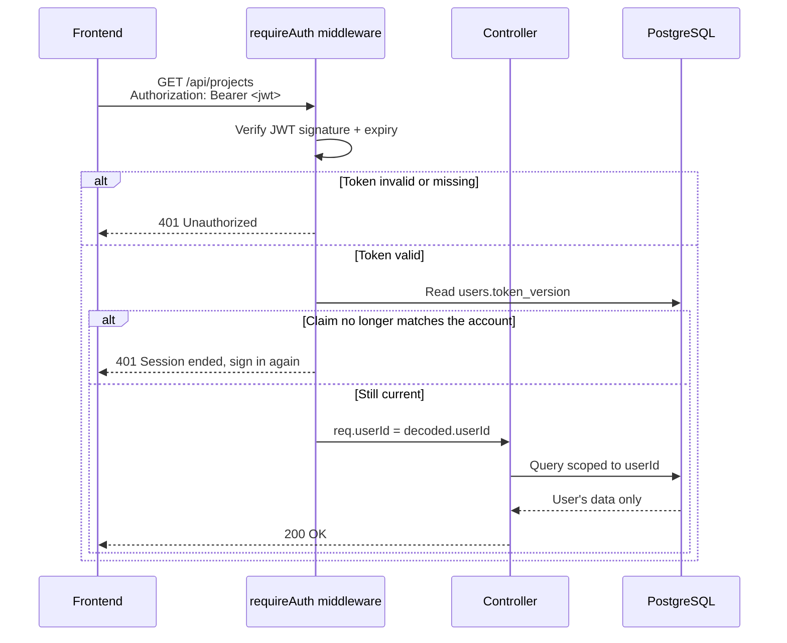
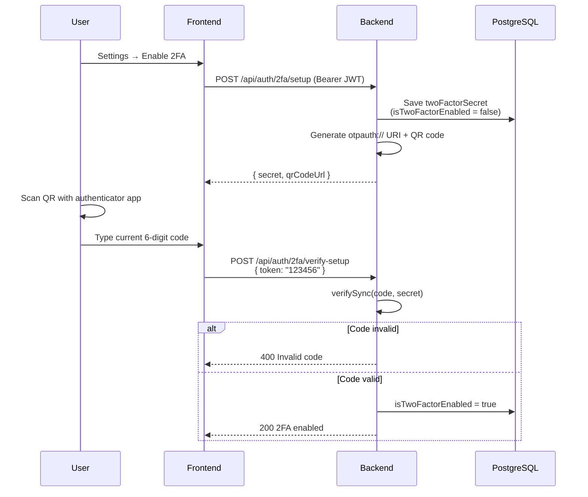

# Authentication & Security — Digital Logbook Backend

This document explains, in depth, how authentication and security work in the Digital Logbook API: what each piece does, why it was built that way, and where the known limitations are. It is written so that anyone reviewing the code (teammates, markers, or a security reviewer) can understand the system without tracing every file.

---

## Table of Contents

1. [The Big Picture](#the-big-picture)
2. [Key Files](#key-files)
3. [Core Authentication Flows](#core-authentication-flows)
   - [Registration & Email Verification](#1-registration--email-verification)
   - [Login (without 2FA)](#2-login-without-2fa)
   - [Password Reset](#3-password-reset)
   - [Logout & Session Revocation](#4-logout--session-revocation)
   - [Account Deletion](#5-account-deletion)
4. [Two-Factor Authentication (TOTP)](#two-factor-authentication-totp)
   - [How TOTP Works in General](#how-totp-works-in-general)
   - [Enabling 2FA (Setup Flow)](#enabling-2fa-setup-flow)
   - [Logging in with 2FA](#logging-in-with-2fa)
   - [Disabling 2FA](#disabling-2fa)
   - [Regenerating recovery codes](#regenerating-recovery-codes)
5. [Database Schema & Migrations](#database-schema--migrations)
6. [Security Properties & Design Decisions](#security-properties--design-decisions)
7. [Known Limitations & Future Improvements](#known-limitations--future-improvements)
8. [Frequently Asked Questions](#frequently-asked-questions)

---

## The Big Picture

The Digital Logbook uses **JWT-based authentication with optional TOTP two-factor authentication**:

- **JWT (JSON Web Token)** — after a successful login, the server issues a signed token. The frontend sends it with every request in the `Authorization: Bearer <token>` header, and protected routes verify it before doing anything.
- **TOTP (Time-based One-Time Password)** — the 6-digit rotating codes generated by authenticator apps like Google Authenticator or Authy. This is an *optional, per-user* second factor: users who enable it must provide a current code in addition to their password.
- **Recovery codes** — ten single-use codes issued when 2FA is enabled, so losing the authenticator device does not mean losing the account. Only SHA-256 digests of the codes are stored.
- **Secret encryption at rest** — TOTP secrets are encrypted with AES-256-GCM under `TWO_FACTOR_ENCRYPTION_KEY` before they are stored, so a database leak alone cannot mint valid codes.

**TOTP in one sentence:** during setup the server and the user's phone share a secret; both sides independently compute a code from *secret + current time window*, so the correct code can only be produced by someone holding the secret — and each code is only valid for ~30 seconds.

All of the auth logic is hand-written Express route handlers built on **established, battle-tested libraries** — `bcryptjs` for password hashing, `jsonwebtoken` for tokens, `otplib` for TOTP, and `nodemailer` for email delivery. No custom cryptography anywhere.

---

## Key Files

| File | Role |
|---|---|
| [`src/routes/auth.routes.ts`](src/routes/auth.routes.ts) | All authentication endpoints: register, login, logout, 2FA setup/verify/disable/recovery-codes, email verification, password reset, account deletion |
| [`src/utils/auth.ts`](src/utils/auth.ts) | Password hashing (`bcryptjs`, 10 salt rounds), JWT sign/verify (7-day expiry, carrying the account's session version), and the 5-minute purpose-scoped `2fa-pending` token that links the two login steps |
| [`src/utils/twoFactorSecret.ts`](src/utils/twoFactorSecret.ts) | AES-256-GCM encryption/decryption of TOTP secrets under `TWO_FACTOR_ENCRYPTION_KEY`, with detection of pre-encryption plaintext rows |
| [`src/utils/tokens.ts`](src/utils/tokens.ts) | Raw-token generation, SHA-256 token digests, and the recovery-code vocabulary (generation, normalisation, digests) |
| [`src/middleware/auth.middleware.ts`](src/middleware/auth.middleware.ts) | `requireAuth` middleware — verifies the `Bearer` token, confirms the account still exists and still holds the token's session version, attaches `req.userId` |
| [`packages/shared/src/auth.ts`](../../../packages/shared/src/auth.ts) | Zod validation schemas for every auth request body, shared between frontend and backend |
| [`src/utils/email.ts`](src/utils/email.ts) | Email delivery helpers for verification and password-reset mails |
| [`prisma/schema.prisma`](prisma/schema.prisma) | The `User`, `PasswordReset` and `TwoFactorRecoveryCode` models — where auth data lives |

### Request lifecycle on a protected route



Because every protected query is scoped by the `userId` embedded in the (server-signed) JWT, one user can never read or modify another user's projects or entries. The extra read of `token_version` is one lookup on the primary key, and it is what makes a signed-out token stop working — see [Logout & Session Revocation](#4-logout--session-revocation).

---

## Core Authentication Flows

### 1. Registration & Email Verification

**`POST /api/auth/register`** with `{ fullName, email, password }`:

1. The request body is validated with the shared Zod schema (`registerSchema`). Invalid input returns `400` with per-field errors.
2. If the email already exists, the endpoint returns `409` — but the same "already exists" check also prevents duplicate accounts from being created.
3. The password is **never stored in plain text**. It is hashed with bcrypt (10 salt rounds) and only the `passwordHash` is saved.
4. A 32-byte random verification token (`crypto.randomBytes(32).toString("hex")`) is generated with a **1-hour expiry**; only its **SHA-256 digest** is stored on the user record, so a database leak cannot be used to verify an email.
5. Email delivery has two modes:
   - **Production (email configured):** a verification email containing a link (`/verify-email?token=...`) is sent via the configured provider — Resend (recommended) or Gmail SMTP.
   - **Dev mode (no SMTP credentials):** the account is auto-verified and the link is logged to the server console — this keeps local development friction-free.

**`POST /api/auth/verify-email`** with `{ token }`:

- The server looks up a user whose `emailVerificationToken` matches **and** whose `emailVerificationExpiry` is still in the future. Expired or unknown tokens return `400`.
- On success the account is marked verified and the token is cleared.

**Login is blocked until verification completes** — an unverified user attempting to log in receives `403` with a clear message. This proves account ownership before granting access.

### 2. Login (without 2FA)

**`POST /api/auth/login`** with `{ email, password }`:

1. Validate the body with Zod.
2. Look up the user by email. If no user exists, return `401 Invalid email or password`.
3. Compare the submitted password against the stored hash with `bcrypt.compare`. Wrong password → `401`.
4. If the account is not email-verified → `403` (see above).
5. If 2FA is **enabled**, the response is **not** a token — see [Logging in with 2FA](#logging-in-with-2fa).
6. Otherwise, sign and return a JWT with a **7-day expiry**, along with the basic user profile.

> **Why the generic error message?** "Invalid email or password" deliberately does not reveal *which* of the two was wrong. Telling an attacker "that email isn't registered" vs. "wrong password" lets them enumerate which emails have accounts.

### 3. Password Reset

The reset flow is deliberately split into two endpoints so the secret (the token) travels only by email:

**`POST /api/auth/forgot-password`** with `{ email }`:

1. If no user exists with that email, the endpoint **still returns the same success message** — "If account exists, a password reset email has been sent." This prevents email enumeration: an attacker probing the endpoint learns nothing about which emails are registered.
2. For a real user, a fresh 32-byte random token is generated and stored in the `password_resets` table with a **1-hour expiry**.
3. A reset email containing the token as a link is sent via SMTP. A failure to send is logged server-side but does not leak information to the caller.

**`POST /api/auth/reset-password`** with `{ token, newPassword }`:

1. Find a reset record where the token matches and `expiresAt` is still in the future — otherwise `400 Invalid or expired password reset token`.
2. Hash the new password with bcrypt.
3. **Atomically**, in a single database transaction:
   - update the user's `passwordHash` and increment `tokenVersion`, and
   - delete **all** of that user's reset tokens (single-use semantics — a token can never be replayed, and any outstanding tokens are invalidated the moment the password changes).

The version bump is what withdraws the sessions: every token issued before the
reset stops being accepted, including one that was stolen before the password
was changed.

### 4. Logout & Session Revocation

A JWT cannot be un-signed, so revocation is expressed as a **version** the
account holds and every token claims:

- `users.token_version` starts at 0. `generateToken(userId, version)` puts it in
the token as `ver`, and `requireAuth` compares the two on every request.
- `POST /api/auth/logout` increments the column and returns `204`. From then on
every token minted under the old version is refused — the one the caller signed
out with, and every other device's.
- Resetting a password and scheduling an account for deletion increment it too,
in the same write as the change they make.

Two consequences worth stating plainly:

- **Revocation is per account, not per device.** Signing out on a phone signs
  the laptop out as well. Per-device revocation would need each token to carry
  an identifier and a denylist of revoked identifiers, plus a job to expire
  them; one integer per account is the trade this design makes.
- **Tokens issued before the column existed still work.** They carry no `ver`
  claim, which is read as 0 — the column's default — so adding it signed nobody
  out. Anything unreadable in the claim is treated the same way rather than
  trusted.

### 5. Account Deletion

**`DELETE /api/auth/account`** with `{ confirmPassword }` (requires `Authorization: Bearer <jwt>`):

1. Verify the caller's current password against the stored hash. A stolen JWT alone is not enough to delete the account — this is a deliberate re-authentication step.
2. Schedule the deletion: the account enters a **30-day grace period**, ending at midnight 30 days out, and a confirmation email is sent. During the grace period the owner can still sign in (the login response carries `scheduledDeletionAt`) and can cancel with `POST /api/auth/account/cancel-deletion`.
3. Scheduling it increments `tokenVersion`, so asking for the account to be deleted also signs out every device.
4. Once the grace period has ended, the purge job deletes the user row. Every foreign key in the schema uses `ON DELETE CASCADE`, so all projects, entries, field values, and reset tokens are erased in the same operation — satisfying the "full account erasure" requirement.

---

## Two-Factor Authentication (TOTP)

2FA is **opt-in, per user**. The frontend checks `GET /api/auth/2fa/status` (a protected endpoint that simply returns `{ isTwoFactorEnabled }`) to know which UI to show.

### How TOTP Works in General

1. During setup, the server generates a random secret and shares it with the user exactly once (via QR code).
2. The user's authenticator app stores the secret alongside the issuer and account label.
3. From then on, both sides independently derive the same 6-digit code from `HMAC(secret, current_30s_time_window)`.
4. The server verifies a submitted code by recomputing it for the current time window. Correct code ⇒ the requester holds the secret.

The secret never leaves the user's phone again after setup, and codes expire within ~30 seconds, which is what makes stolen (or shoulder-surfed) codes nearly useless.

### Enabling 2FA (Setup Flow)

The setup is intentionally a **two-step process** — the factor is only activated after the user proves their authenticator is correctly configured:



**Step 1 — `POST /api/auth/2fa/setup`** (protected):

- Rejects the request if 2FA is already enabled.
- Returns `503` if `TWO_FACTOR_ENCRYPTION_KEY` is not configured — the server refuses to store a secret it cannot protect, rather than falling back to plaintext.
- Generates a TOTP secret with `otplib`'s `generateSecret()`.
- Builds an `otpauth://` URI with issuer `"Digital Logbook"` and the user's email as the label — this is what makes the entry in the authenticator app say "Digital Logbook: user@wits.ac.za" instead of a bare secret.
- Renders that URI as a **QR code** (base64 data URL via the `qrcode` library) so the user can scan it instead of typing the secret by hand.
- Saves the secret **immediately** — **encrypted with AES-256-GCM** — but with `isTwoFactorEnabled: false`: the factor is *staged, not active*.

**Step 2 — `POST /api/auth/2fa/verify-setup`** (protected) with `{ token }`:

- Requires that a setup is in progress (a secret exists and 2FA isn't already on).
- Verifies the submitted 6-digit code against the staged secret (decrypting it first) with `verifySync`.
- Only on success does it flip `isTwoFactorEnabled: true`.
- Issues **ten single-use recovery codes** and returns them in this response — the only time they exist in readable form; the database stores only their SHA-256 digests.

**Why the two steps?** If the server enabled 2FA at step 1 and the user's QR scan silently failed, the user would be locked out at their very next login. Requiring a successful code first guarantees the user's authenticator genuinely shares the secret before the factor becomes mandatory for them.

### Logging in with 2FA

With 2FA enabled, login becomes a two-request sequence:

**Step 1 — `POST /api/auth/login`** (email + password):

- Email, password, and email-verification checks all run exactly as in the normal flow.
- If they pass **but** `isTwoFactorEnabled` is true, the endpoint deliberately returns **no JWT**:
  ```json
  { "requiresTwoFactor": true, "email": "user@wits.ac.za", "twoFactorToken": "eyJ..." }
  ```
  The password check has succeeded — but possession of the second factor has not yet been demonstrated, so no session credential is issued. The `twoFactorToken` is a **short-lived (5-minute), purpose-scoped JWT** (`purpose: "2fa-pending"`) that identifies the account whose password just verified. It is not a session token: the middleware rejects it on protected routes.

**Step 2 — `POST /api/auth/login/2fa`** with `{ twoFactorToken, code }`:

- Verifies the pending token — this is what makes the second step part of *this* sign-in. An expired or missing token returns `401` and asks the user to sign in again; the account is identified by the token the server issued after the password verified, never by an email address in the request body. (Before this change, step 2 could be called standalone with any email and a valid code, which made the second factor a *replacement* for the password rather than an addition to it — BUG-006.)
- Accepts either the current 6-digit TOTP code, or one of the ten recovery codes (recognised by shape). A recovery code is spent atomically — the row's `used_at` is only set if it was still `NULL`, so the same code cannot be replayed even by two concurrent requests.
- Wrong code → `401 Invalid authentication code`.
- Correct code → the JWT is finally issued; the response shape matches a normal login, plus `usedRecoveryCode` and the user's remaining `recoveryCodesRemaining`.
- On a TOTP sign-in, a secret that predates encryption (stored before `TWO_FACTOR_ENCRYPTION_KEY` existed) is transparently re-encrypted — the plaintext rows drain away on their own, no backfill window needed.

### Disabling 2FA

**`POST /api/auth/2fa/disable`** with `{ password }` (protected):

- Requires the account password to be re-supplied and verified — a momentarily-stolen session token cannot silently strip the user's second factor.
- In one transaction: `isTwoFactorEnabled` is set to `false`, the stored `twoFactorSecret` is cleared, and **every recovery code is deleted**. The codes are only meaningful alongside a secret; leaving them behind would let a stale one unlock a later, unrelated 2FA setup.

### Regenerating recovery codes

**`POST /api/auth/2fa/recovery-codes`** with `{ password }` (protected):

- Gated on the account password, exactly as disabling 2FA is — otherwise a borrowed session could quietly mint itself a permanent way back in.
- Issues a fresh set of ten codes and invalidates every previous one. The response is the only place the new codes are readable.

---

## Database Schema & Migrations

Everything auth-related lives in three models:

```prisma
model User {
  id                      String    @id @default(uuid()) @db.Uuid
  email                   String    @unique @db.VarChar(255)
  passwordHash            String    @map("password_hash") @db.VarChar(255)
  fullName                String    @map("full_name") @db.VarChar(255)
  isEmailVerified         Boolean   @default(false) @map("is_email_verified")
  emailVerificationToken  String?   @map("email_verification_token") @db.VarChar(255)
  emailVerificationExpiry DateTime? @map("email_verification_expiry")
  twoFactorSecret         String?   @map("two_factor_secret") @db.VarChar(255)
  isTwoFactorEnabled      Boolean   @default(false) @map("is_two_factor_enabled")
  tokenVersion            Int       @default(0) @map("token_version")
  // ... timestamps, relations
}

model PasswordReset {
  id        String   @id @default(uuid()) @db.Uuid
  userId    String   @map("user_id") @db.Uuid
  tokenHash String   @map("token_hash") @db.VarChar(255)
  expiresAt DateTime @map("expires_at")
  user      User     @relation(fields: [userId], references: [id], onDelete: Cascade)
}

model TwoFactorRecoveryCode {
  id        String    @id @default(uuid()) @db.Uuid
  userId    String    @map("user_id") @db.Uuid
  codeHash  String    @map("code_hash") @db.VarChar(64)
  usedAt    DateTime? @map("used_at")
  createdAt DateTime  @default(now()) @map("created_at")

  user User @relation(fields: [userId], references: [id], onDelete: Cascade)

  @@unique([userId, codeHash])
  @@index([userId])
  @@map("two_factor_recovery_codes")
}
```

Two things the column names alone do not say:

- `twoFactorSecret` stores the TOTP secret **encrypted** (AES-256-GCM, a versioned `v1.<iv>.<tag>.<ciphertext>` envelope) — never plaintext. Rows written before encryption landed keep working and are re-encrypted the next time their owner signs in.
- `tokenHash` on `PasswordReset` and `codeHash` on `TwoFactorRecoveryCode` hold **SHA-256 digests**, not the values themselves. A database leak yields hashes; the raw tokens exist only in the emails (or, for recovery codes, in the one-time `verify-setup`/`recovery-codes` responses) and in the user's hands.
- `tokenVersion` is the account's current session version. Every token names the version it was minted under; a mismatch means the session was withdrawn. It is the only state the server keeps about a session, and it is why logout can end a token that was never stored anywhere.

### Do you need a migration for auth?

The auth columns and tables are part of the database baseline. The project
uses the **Prisma Migrate** workflow: the whole schema — including
`two_factor_secret`, `is_two_factor_enabled`, `password_resets` and
`two_factor_recovery_codes` — is created by the single squashed baseline
`prisma/migrations/0_init` (`npx prisma migrate deploy` from
`apps/backend/`). Columns added later arrive as their own migrations —
`20261125140000_session_token_version` is the one that added `token_version` —
and `migrate deploy` applies whichever are outstanding. See the
[backend README](README.md) for the current setup steps.

---

## Security Properties & Design Decisions

| Property | How it is achieved |
|---|---|
| **Passwords never stored in plain text** | bcrypt with per-password salt (10 rounds). Hashes are non-reversible and salt defeats rainbow tables. |
| **Tokens can't be forged** | JWTs are signed with `JWT_SECRET`; a modified payload invalidates the signature. |
| **Session expiry** | JWTs expire after 7 days, forcing periodic re-authentication. |
| **Sessions can be withdrawn** | Each token carries the account's `tokenVersion`; `requireAuth` refuses a mismatch. Logout, password reset and scheduling deletion increment it, so a copied token stops working the moment its owner acts. |
| **No account enumeration via login** | Identical `Invalid email or password` for unknown email and wrong password. |
| **No account enumeration via forgot-password** | Same response message whether or not the email exists. |
| **Reset tokens are single-use** | All of a user's reset tokens are deleted in the same transaction that updates the password. |
| **Reset tokens are short-lived** | 1-hour expiry, enforced both in the query and by the `expiresAt` column. |
| **Reset/verification tokens stored hashed** | Only SHA-256 digests are stored; a database leak cannot be replayed against the endpoints. |
| **High-entropy tokens** | `crypto.randomBytes(32)` → 256 bits of randomness; brute-forcing is infeasible. |
| **Email ownership proven before access** | Login returns `403` until the email is verified. |
| **Account deletion is re-authenticated** | Requires the current password, not just a valid session. |
| **Full data erasure** | `ON DELETE CASCADE` on every user-owned relation. |
| **Request validation everywhere** | Shared Zod schemas reject malformed input with structured `400` errors before any logic runs. |
| **Ownership enforced server-side** | Every protected query is scoped by the JWT's `userId` — cross-user access is impossible regardless of what the client sends. |
| **2FA lockout protection** | Enabling and disabling 2FA both require proof the user controls the account (JWT, and password for disable). |
| **TOTP secrets encrypted at rest** | AES-256-GCM under `TWO_FACTOR_ENCRYPTION_KEY`; setup returns `503` rather than storing plaintext when the key is missing. |
| **Recovery codes are hashed and single-use** | SHA-256 digests only; spending is atomic (`used_at IS NULL` guard), so a code cannot be replayed. |
| **2FA login steps cryptographically linked** | Step 1 issues a 5-minute purpose-scoped `2fa-pending` token; step 2 refuses to proceed without it, and the middleware rejects it as a session token. |
| **Rate limiting on auth endpoints** | Separate express-rate-limit windows for register, login and 2FA code attempts (configurable via `RATE_LIMIT_*`). |

---

## Known Limitations & Future Improvements

The five limitations this section originally listed — no 2FA recovery codes, plaintext TOTP secrets, unlinked 2FA login steps, a hardcoded `JWT_SECRET` fallback, and no rate limiting — were all resolved by the September 2026 security hardening (BUG-002, BUG-003, BUG-004, BUG-005 and BUG-006). What remains is a shorter, still-honest list of the deliberate scope decisions that survive that work:

1. **`TWO_FACTOR_ENCRYPTION_KEY` is now production-critical.** It must be set before anyone can enable 2FA — setup returns `503` without it rather than storing an unprotected secret — and it must never be rotated casually or lost. Losing it makes every stored TOTP secret undecryptable: affected users can still sign in with a recovery code, but TOTP codes stop verifying until they disable and re-enrol 2FA. Any strong string works as the key (it is SHA-256-hashed to the AES-256 key length), so the operational rule is the same as for `JWT_SECRET`: generate once, put it in the deployment environment, back it up.
2. **Recovery codes are shown exactly once.** They exist in readable form only in the `verify-setup` and `recovery-codes` responses; the database keeps SHA-256 digests, so there is no "show my codes again" — only regeneration, which is password-gated and invalidates the previous set. A user who skips storing them and then loses both the authenticator and the codes needs an administrator to clear `twoFactorSecret`.
3. **Sessions are revoked per account, not per device.** Signing out, resetting a password or scheduling deletion withdraws every token the account has issued, so a sign-out on one device signs the others out too. Per-device revocation — "sign out everywhere except here" — would need each token to carry an identifier, a denylist of withdrawn identifiers, and a job to expire the rows; the version column trades that machinery for a coarser guarantee. Recorded here so reviewers see the trade was weighed. *Possible future improvement: a `jti` per token, or `httpOnly` cookies, which would also answer the `localStorage` exposure in the audit.*

---

## Frequently Asked Questions

**Q: Is 2FA mandatory?**
No — it is opt-in per user. `GET /api/auth/2fa/status` tells the frontend whether the signed-in user has it enabled (and how many recovery codes remain), so the UI can offer to enable it and show the code prompt at login.

**Q: What happens if a user loses their phone?**
They sign in with one of their ten recovery codes (a code is accepted anywhere a TOTP code is, and is spent on use). While still signed in — on another device, say — they can disable 2FA or generate a fresh set of codes. Only when both the authenticator *and* the codes are gone does recovery need an administrator to clear `two_factor_secret`.

**Q: Is the TOTP secret encrypted at rest?**
Yes — AES-256-GCM under `TWO_FACTOR_ENCRYPTION_KEY`, stored as a versioned `v1.<iv>.<tag>.<ciphertext>` envelope. `/api/auth/2fa/setup` returns `503` when the key is not configured, and any pre-encryption plaintext row is re-encrypted the next time its owner signs in.

**Q: How are the two 2FA login steps linked?**
Step 1 (password verified) returns a 5-minute, purpose-scoped `twoFactorToken`; step 2 demands it and refuses to proceed without it. The token is signed with `JWT_SECRET` but carries `purpose: "2fa-pending"`, so the auth middleware rejects it on every protected route — it can only ever be used to finish that one sign-in.

**Q: Why does `login` sometimes return `200` with no token?**
That is the 2FA path: `{ requiresTwoFactor: true, email, twoFactorToken }` tells the frontend to prompt for the 6-digit code (or a recovery code) and call `/api/auth/login/2fa`. The password has already been verified at that point — only the second factor is outstanding.

**Q: Are reset tokens hashed in the database?**
Yes. `password_resets.token_hash`, the users' email-verification tokens and the 2FA recovery codes all store SHA-256 digests, never the raw values. The raw token exists only in the email link (or the one-time recovery-codes response).

**Q: What happens if `TWO_FACTOR_ENCRYPTION_KEY` is lost or changed?**
Every stored TOTP secret becomes unreadable. Affected users can still sign in with a recovery code, but TOTP codes stop verifying until they disable and re-enrol 2FA. This is why the key must be generated once and backed up like `JWT_SECRET` — see limitation 1.

**Q: Which parts of the auth system are hand-written vs. library-based?**
Only the *orchestration* is hand-written (routes, flows, status codes, validation). All cryptographic primitives come from established libraries: `bcryptjs` (hashing), `jsonwebtoken` (JWT), `otplib` (TOTP), `node:crypto` (random bytes, AES-256-GCM, SHA-256). No custom crypto exists anywhere in the codebase.

---

*Last reviewed: September 2026, after the 2FA security hardening (BUG-002 through BUG-006). For the full endpoint table and setup instructions, see the [main backend README](README.md).*
