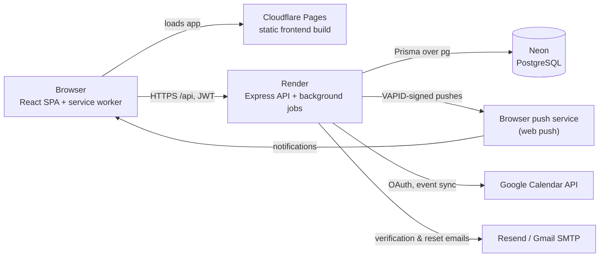

# System Architecture

The Digital Logbook is a single-page React application talking to an Express REST API, backed by PostgreSQL. Frontend, backend and a shared types package live in one npm-workspaces monorepo.

## 1. Deployment Overview



| Part | Hosted on | Notes |
|---|---|---|
| Frontend | Cloudflare Pages (`*.pages.dev`) | Static Vite build. A production build calls the Render API directly; the dev server proxies `/api` to `localhost:3000` instead. |
| Backend | Render | One Node process serving the API and running the background jobs (§6). On the free tier it sleeps when idle, and the jobs pause with it. |
| Database | Neon (serverless PostgreSQL) | Reached through Prisma's `pg` driver adapter. |
| CI | Gitea Actions (`.gitea/workflows/deploy.yaml`) | Installs, typechecks, lints, tests and builds on every push. It deploys nothing; both deployments are done by hand. |

The backend only accepts browser requests from `localhost` and `*.pages.dev` origins (CORS, `apps/backend/src/app.ts`).

**Delivery.** A push to `main` runs CI (typecheck, lint, both test suites with
coverage against a throwaway test database, builds) and, once it passes,
deploys: a Render deploy hook rebuilds the API — whose container applies any
pending migrations before serving — and Wrangler publishes the frontend to
Cloudflare Pages. A scheduled workflow keeps the free-tier API awake. See
[Deployment](setup.md#deployment).

## 2. Tech Stack

| Layer | Technology | Version | Purpose | Why Chosen |
|---|---|---|---|---|
| **Frontend** | React | 19 | UI framework | Component-based architecture, large ecosystem, team familiarity |
| | Vite | 8 | Dev server & build tool | Fast HMR, native ESM, simpler config than Webpack |
| | TypeScript | 6 | Type safety | Catches errors at compile time, shared types with backend |
| | Tailwind CSS | 4 | Utility-first styling | Consistent design tokens, dark mode, responsive utilities |
| | React Router | 7 | Client-side routing with protected routes | Standard React routing, nested layouts and route guards |
| | Axios | 1 | HTTP client | Interceptors attach the JWT and handle expired sessions in one place |
| | Lucide React | — | Icons | Lightweight, tree-shakeable, consistent icon set |
| **Backend** | Express | 5 | HTTP API framework | Minimal, flexible, large middleware ecosystem |
| | Zod | 4 | Request validation | Runtime validation with TypeScript inference, shared with the frontend |
| | Prisma ORM | 7 | Database access & migrations | Type-safe queries generated from the schema |
| | bcryptjs | 3 | Password hashing | Industry standard, pure JS |
| | jsonwebtoken | 9 | Session tokens | Stateless authentication |
| | otplib, qrcode | 13, 1 | TOTP two-factor authentication | RFC 6238 TOTP, QR codes for authenticator apps |
| | express-rate-limit | 8 | Rate limiting on auth routes | Blocks password and 2FA guessing |
| | web-push | 3 | Reminder push notifications | Standard VAPID web push, no third-party service |
| | googleapis | — | Google Calendar sync | Official Google client |
| | resend, nodemailer | — | Transactional email | Resend preferred; Gmail SMTP as a fallback |
| **Database** | PostgreSQL on Neon | — | Relational storage | ACID guarantees; serverless hosting with branching |
| | `@prisma/adapter-pg` | 7 | Prisma driver adapter | Lets Prisma use the `pg` driver against Neon |
| **Shared** | `@logbook/shared` | 1.0.0 | Types and Zod schemas used by both apps | One source of truth for data shapes |
| **Testing** | Vitest | 4 | Test runner for both apps | Native ESM, fast, shares Vite's config |
| | Supertest | 7 | Backend HTTP integration tests | Full request/response cycle without starting a server |
| | Testing Library, jsdom | — | Frontend component and page tests | Tests behaviour as a user sees it |
| **Workspace** | npm workspaces | — | Monorepo package management | Built into npm, no extra tooling |

## 3. Monorepo Layout

```
coms3011a-logbook-digital-logbook/
├── apps/
│   ├── frontend/                  # React + Vite SPA
│   │   ├── public/sw.js           # Service worker: offline app shell, push notifications
│   │   ├── src/
│   │   │   ├── pages/             # One component per route (§7)
│   │   │   ├── components/        # Reusable UI and feature widgets
│   │   │   ├── lib/               # Non-UI logic: offline cache and queue, reminder
│   │   │   │                      #   notifications, dashboard insights, saved filters
│   │   │   ├── api/client.ts      # Axios instance, JWT and expired-session interceptors
│   │   │   ├── api.ts             # Typed wrapper for every API call
│   │   │   ├── App.tsx            # Routes (public + protected)
│   │   │   └── main.tsx           # Entry point; registers the service worker in production
│   │   └── vite.config.ts         # /api proxy to the backend; Vitest config
│   │
│   └── backend/                   # Express REST API
│       ├── prisma/
│       │   ├── schema.prisma      # 20 models (§4)
│       │   └── migrations/        # 0_init baseline + dated migrations
│       └── src/
│           ├── routes/            # Express routers, one per area
│           ├── controllers/       # Request handling per area
│           ├── schemas/           # Zod request schemas
│           ├── middleware/        # requireAuth (JWT), rate limiting
│           ├── utils/             # Domain logic: entry formats and versions, computed
│           │                      #   fields, expressions, automation, recurrence,
│           │                      #   reminders, push, tags, token and crypto helpers
│           ├── services/          # Google Calendar client
│           ├── jobs/              # Background jobs started with the server (§6)
│           ├── __tests__/         # Vitest + Supertest suite
│           ├── app.ts             # Express app (exported for tests)
│           ├── index.ts           # Starts the server and the jobs
│           └── prisma.ts          # Prisma client singleton
│
├── packages/shared/               # @logbook/shared: types and Zod schemas
├── docs/                          # This documentation (MkDocs)
└── mkdocs.yml
```

## 4. Data Model

The schema in `apps/backend/prisma/schema.prisma` has twenty models. See [Database design](design/database-erd.md) for the full diagram; they group as follows.

| Area | Models | Notes |
|---|---|---|
| Accounts | `User`, `PasswordReset`, `TwoFactorRecoveryCode` | Reset and verification tokens are stored hashed. TOTP secrets are encrypted at rest. |
| Projects & formats | `Project`, `EntryField`, `EntryFormatVersion` | A project's entry format is its fields. Each format change writes an immutable `EntryFormatVersion`, and an entry stays pinned to the version it was created under. |
| Entries | `LogbookEntry`, `EntryValue` | One `EntryValue` row per field per entry, stored as text and interpreted by the field's type. Entries carry duration, entry and due dates, an `OPEN`/`DONE` status, and an `archivedAt` marker. |
| History | `EntryVersion` | A full snapshot of the entry on every create, edit, restore and automated change. Rows are never updated. |
| Tags | `Tag`, `ProjectTag`, `EntryTag` | User-scoped labels for projects and entries. |
| Statistics & dashboard | `CustomStatistic`, `DashboardLayout` | Saved expressions, and the user's chosen dashboard panels in order. |
| Automation | `AutomationRule`, `RecurrenceRule` | Rules applied when entries are saved, and templates for repeating entries. |
| Reminders | `Reminder`, `ReminderSettings`, `PushSubscription` | Manual and rule-generated reminders, each user's rules, and the devices subscribed to push. |
| Integrations | `GoogleCalendarConnection` | Encrypted OAuth tokens for Calendar sync. |

**Field types** (`EntryFieldType`): `TEXT`, `NUMBER`, `DATE`, `BOOLEAN`, `TAGS`, `CHECKLIST`, `LINK`, `REFERENCE`, `COMPUTED`.

**Key constraints:** one account per email; project names unique per user; field names unique per project (case-insensitive, among non-archived fields); one value per field per entry; version numbers unique per entry. Foreign keys cascade on delete, so deleting an account erases all of its data.

## 5. API

All routes are under `/api` and, apart from sign-up, sign-in, password reset and the health checks, need a `Bearer` JWT. Every request body is validated with Zod (`400` on failure), and every resource is checked against the signed-in user (`404` for another user's data). The full list with request and response shapes is in the [API Reference](api-reference.md).

| Area | Base paths |
|---|---|
| Authentication, 2FA, account | `/auth/*` |
| Projects | `/projects`, `/projects/:id`, `/projects/:id/time-summary`, `/projects/:id/status` |
| Entry fields & formats | `/projects/:projectId/entry-fields`, `/projects/:projectId/entry-format-versions`, `/entry-fields/:id` |
| Entries | `/entries`, `/projects/:projectId/entries`, `/entries/:id`, `/entries/:id/status`, `/me/open-entries` |
| Backup & restore | `/import` |
| History & archive | `/entries/:id/versions`, `/entries/:id/versions/at`, `/entries/:id/versions/:version/restore`, `/entries/archive`, `/entries/:id/archive` |
| Statistics | `/projects/:projectId/stats/{group,timeline,expression}`, `/projects/:projectId/custom-statistics` |
| Automation | `/projects/:projectId/automation-rules`, `/recurrences/:id` |
| Reminders & push | `/reminders`, `/reminders/count`, `/reminders/settings`, `/push/public-key`, `/push/subscriptions` |
| Dashboard | `/dashboard/layout` |
| Tags | `/tags` |
| Google Calendar | `/google-calendar/{connect,callback,status,sync,disconnect}` |
| Utility | `/health`, `/db-check` |

## 6. Key Flows

### Saving an entry

Creating or editing an entry (`entry.controller.ts`) happens in this order:

1. The request is validated, each value is checked against its field's type, computed fields are calculated from the supplied values, and required fields are checked.
2. In one database transaction, the entry and its values are written and an `EntryVersion` snapshot is recorded.
3. After the transaction commits, matching automation rules run (`utils/automationRunner.ts`). They can add or remove tags or set the status, and record their change as a further version. Rules cannot trigger themselves or each other, and a failing rule is skipped. Running them after the commit means a broken rule can never cost the user their entry.

Because every save writes a version, the history, "as of a date" view and restore features all read from the same `EntryVersion` rows.

### Background jobs

`src/index.ts` starts three jobs with the server:

| Job | Interval | Does |
|---|---|---|
| `recurringEntries` | every minute | Creates entries whose recurrence rule has fallen due |
| `pushReminders` | every minute | Generates each subscribed user's reminders from their rules and pushes the ones now due. Off when the VAPID keys are not set. |
| `purgeDeletedAccounts` | every hour | Permanently deletes accounts whose 30-day deletion grace period has ended |

The jobs run only while the server is awake. The work is also done on demand: listing entries creates any due recurring entries, and reading reminders generates them, so nothing is lost while the server sleeps. Only push notifications wait until it wakes.

### Reminders and notifications

Reminders come from the user (`MANUAL`) or from their rules (`DUE_SOON`, `OVERDUE`, `STALE`, `DAILY_LOG`). A device can be notified in two ways:

* **Push:** where the browser supports it and the server has VAPID keys, the browser subscribes and the server pushes each reminder as it falls due, even with the logbook closed. `public/sw.js` receives the push and shows it.
* **In-app:** otherwise, an open logbook tab checks for newly due reminders every five minutes and shows them itself.

The service worker is registered only in production builds, so local development always uses the in-app path.

### Offline use

The service worker caches the app shell, so the logbook opens with no connection. API data is cached separately by the app (`lib/offlineCache.ts`), and entries created offline are queued (`lib/offlineEntries.ts`) and sent when the connection returns.

### Sessions

A successful sign-in returns a JWT that lasts seven days, kept in `localStorage`. The Axios client attaches it to every request. A `401` from any route other than the credential checks clears the session and returns the user to `/login?expired=1`.

## 7. Frontend Structure

```
App (BrowserRouter)
├── Public routes
│   ├── /                  LandingPage
│   ├── /login             LoginPage (with 2FA and recovery codes)
│   ├── /register          RegisterPage
│   ├── /verify-email      VerifyEmail
│   ├── /forgot-password   ForgotPasswordPage
│   └── /reset-password    ResetPasswordPage
│
└── Protected routes (ProtectedRoute → AppLayout with Sidebar)
    ├── /dashboard         DashboardPage: chosen and arranged panels, including saved statistics
    ├── /projects          ProjectsPage: projects and their entry formats
    ├── /projects/:id      ProjectDetailPage: entries, format, automation rules
    ├── /entries           EntriesPage: all entries, search, filters, saved filters, archive
    ├── /stats             StatsPage: group-by, timeline, custom expressions, saved statistics
    ├── /open-work         OpenWorkPage: unfinished entries by urgency
    ├── /calendar          CalendarPage: entries by due date, Google Calendar sync
    ├── /board             BoardPage: entries as a board
    ├── /reminders         RemindersPage: reminders and reminder rules
    ├── /settings          SettingsPage: account, 2FA, notifications, data export/import
    └── /profile           ProfilePage
```

Notable components beyond the basic layout, card and state components:

| Component | Purpose |
|---|---|
| `EntryForm`, `ChecklistInput`, `TagInput`, `Stopwatch` | Entry capture for all nine field types, with a live timer |
| `EntryHistoryModal` | Version history, "as of a date" view and restore |
| `AutomationRules` | Create, edit, enable and delete a project's rules |
| `DeadlineReminders` | Upcoming and overdue due dates |
| `GoogleCalendarSync` | Connect, sync and disconnect Google Calendar |
| `BarChart`, `TrendChart`, `WeekComparison` | Statistics and dashboard charts |
| `DeleteProjectModal` | Confirmed project deletion |

`api/client.ts` points the Axios instance at `/api` in development and at the Render URL in production. `api.ts` wraps every endpoint in a typed function.

## 8. Shared Types Package

`@logbook/shared` (`packages/shared/src/`) exports the types and Zod schemas both apps use, such as projects, entry fields, entries, time summaries, their create and update inputs, and the auth schemas (`registerSchema`, `loginSchema` and so on). The backend imports its compiled `dist/`, so the package must be built after changes. The frontend reads the source directly through a Vite alias.

## 9. Security

* Passwords are hashed with bcrypt. Password-reset and email-verification tokens are stored only as hashes.
* TOTP secrets and Google tokens are encrypted at rest with keys from the environment. 2FA has single-use recovery codes, and its second step requires a short-lived token from a successful password check.
* Sign-in, sign-up and 2FA routes are rate limited per IP.
* In production the server refuses to start without `JWT_SECRET`.
* Every entry, project, statistic, rule and reminder query is scoped to the signed-in user.

## 10. Testing

Both apps use Vitest. The backend suite (`apps/backend/src/__tests__/`) runs Supertest integration tests against the database in `.env`, alongside unit tests for pure logic such as expressions and automation conditions. The frontend suite tests components, pages and libraries in jsdom with the API mocked. See [Testing](testing.md) for the strategy and [Setup](setup.md#testing) for how to run them.
