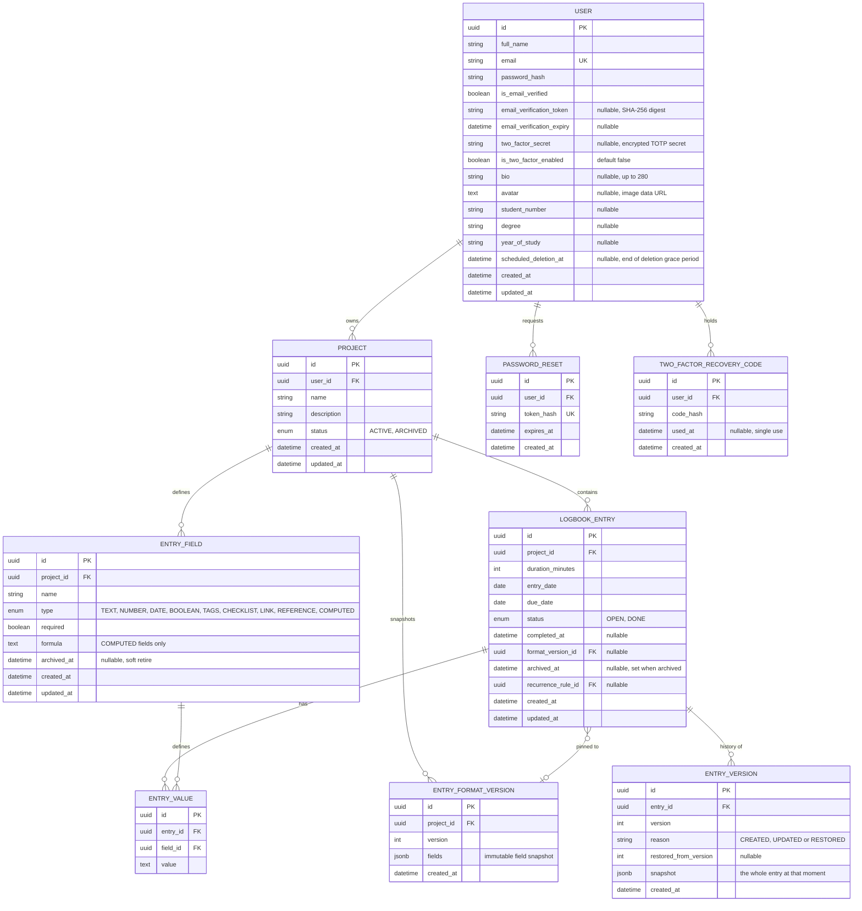
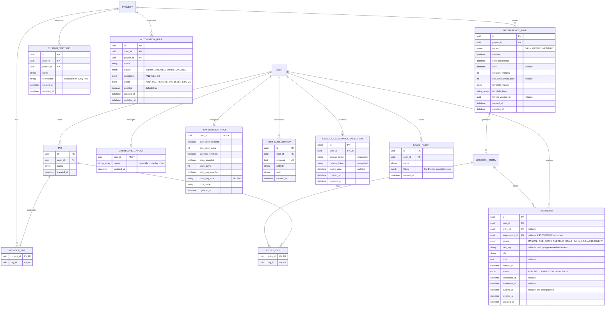
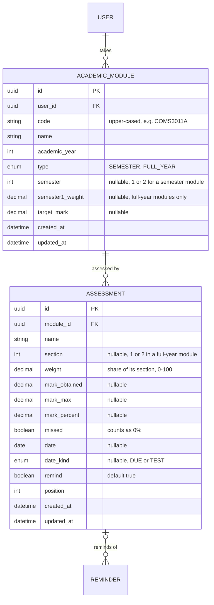

# Database Design

## Overview

The Digital Logbook uses a PostgreSQL database to store users, projects,
project entry formats, logbook entries and their history, and the features
built on top of them: tags, statistics, dashboards, automation, reminders,
saved filters and the My Grades module tracker.

A key design goal was that different projects need different logbook
entry structures (e.g. one project may track "hours worked" and "task
completed", while another tracks "description" and "outcome"). Rather
than hardcoding a fixed set of columns for logbook entries, we adopted
an **Entity-Attribute-Value (EAV)** pattern using `ENTRY_FIELD` and
`ENTRY_VALUE`. This trades some query simplicity for the flexibility of
letting each project define its own entry format without requiring
schema changes.

We use **UUIDs** rather than auto-incrementing integers as primary keys
to avoid exposing sequential, guessable IDs and to make it easier to
merge or migrate data across environments without ID collisions.

The schema has twenty-three tables. The diagrams below split them into the
core logbook, the features around it, and My Grades; `USER`, `PROJECT`,
`LOGBOOK_ENTRY` and `REMINDER` appear in more than one.

## Entity Relationship Diagrams

### Core logbook

### Features around the logbook

### My Grades

### Enums

| Enum | Values | Used by |
|---|---|---|
| `ProjectStatus` | `ACTIVE`, `ARCHIVED` | `projects.status` |
| `EntryFieldType` | `TEXT`, `NUMBER`, `DATE`, `BOOLEAN`, `TAGS`, `CHECKLIST`, `LINK`, `REFERENCE`, `COMPUTED` | `entry_fields.type` |
| `EntryStatus` | `OPEN`, `DONE` | `logbook_entries.status` |
| `AutomationTrigger` | `ENTRY_CREATED`, `ENTRY_UPDATED` | `automation_rules.trigger` |
| `RecurrencePattern` | `DAILY`, `WEEKLY`, `MONTHLY` | `recurrence_rules.pattern` |
| `ReminderStatus` | `PENDING`, `COMPLETED`, `DISMISSED` | `reminders.status` |
| `ReminderSource` | `MANUAL`, `DUE_SOON`, `OVERDUE`, `STALE`, `DAILY_LOG`, `ASSESSMENT` | `reminders.source` |
| `ModuleType` | `SEMESTER`, `FULL_YEAR` | `academic_modules.type` |
| `AssessmentDateKind` | `DUE`, `TEST` | `assessments.date_kind` |

### Constraints

- `USER.email` — Unique. Each email can only register once.
- `PROJECT(user_id, name)` — Unique. A student cannot have two projects with the same name.
- `ENTRY_FIELD(project_id, lower(name))` — Unique among fields that are not archived, so a project cannot have two live fields whose names differ only in capitals. Statistics, expressions and automation rules refer to fields by name, so a duplicate would make them ambiguous.
- `ENTRY_VALUE(entry_id, field_id)` — Unique. One value per field per entry.
- `ENTRY_FORMAT_VERSION(project_id, version)` and `ENTRY_VERSION(entry_id, version)` — Unique. Version numbers increment per project and per entry.
- `TAG(user_id, name)`, `CUSTOM_STATISTIC(project_id, name)`, `AUTOMATION_RULE(project_id, name)` — Unique names within their owner.
- `REMINDER(user_id, rule_key)` — Unique, so a rule-generated reminder is created once however often the rules are applied.
- `PUSH_SUBSCRIPTION.endpoint` — Unique. An endpoint belongs to one browser; if another user signs in on it, the subscription moves to them.
- `TWO_FACTOR_RECOVERY_CODE(user_id, code_hash)` — Unique.
- `ACADEMIC_MODULE(user_id, code, academic_year)` — Unique. Taking a module again in a later year is a new row, not a clash.
- All foreign keys use `ON DELETE CASCADE` for full account erasure, except `logbook_entries.format_version_id` and `logbook_entries.recurrence_rule_id`, which use `ON DELETE SET NULL` — deleting a snapshot or a recurrence rule must not destroy entries.

### Indexes

Besides the unique constraints above, the schema indexes the columns that
common queries filter on: `projects.user_id`, `entry_fields.project_id`,
`logbook_entries` by `project_id`, `status`, `due_date` and
`(project_id, status)`, `entry_values` by `entry_id` and `field_id`,
`entry_versions.entry_id`, `tags.user_id`, and `user_id` on the recovery
code, push subscription and Google Calendar tables. Reminders are indexed on
`(user_id, status, remind_at)` for the due-reminder query,
`recurrence_rules` on `(enabled, next_occurrence)` for the recurrence job, and
`automation_rules` on `(project_id, enabled)` for the rule runner.
`saved_filters.user_id`, `academic_modules(user_id, academic_year)`,
`assessments.module_id` and `reminders.assessment_id` are indexed for the
saved-filter, My Grades and assessment-reminder lookups.

## Main Entities

### User

Represents a student using the Digital Logbook.

A user can have multiple projects and can request multiple password
resets over time.

Passwords are stored as a salted hash (`password_hash`), never as
plain text.

Authentication-related columns:

- `is_email_verified`, `email_verification_token`, `email_verification_expiry` — email ownership is proven before login is allowed. The token is 32 random bytes, expires after one hour, and only its SHA-256 digest is stored.
- `two_factor_secret`, `is_two_factor_enabled` — optional TOTP two-factor authentication. The secret is encrypted with AES-256-GCM before storage. It is staged at setup time and only becomes active (`is_two_factor_enabled = true`) after the user proves their authenticator works.
- `scheduled_deletion_at` — set when the user deletes their account. The account stays usable for a 30-day grace period and is erased by the hourly purge job, or at the next sign-in attempt, once this date has passed.

See `apps/backend/AUTHENTICATION.md` in the repository for the full
authentication design.

### Two-Factor Recovery Code

One of ten single-use codes issued when 2FA is enabled, for signing in
without the authenticator device. Only a digest is stored; `used_at` is set
when a code is spent. Regenerating the codes replaces the whole set.

### Project

Represents a separate project belonging to a student.

A project can contain multiple entry fields, format versions, and
logbook entries. Archiving sets `status = ARCHIVED`; entries stay
editable either way.

### Entry Field

Defines the structure of a project's logbook entries.

For example, a project could define fields such as:

- Description (TEXT)
- Date (DATE)
- Hours worked (NUMBER)
- Task completed (BOOLEAN)

`type` is enforced at the application layer when validating
`ENTRY_VALUE.value`, since the value itself is stored as a string to
support different field types.

Sprint 2 extended the field types beyond the basic four:

| Type | Meaning |
|---|---|
| `TAGS` | A list of short labels |
| `CHECKLIST` | A list of checkable items |
| `LINK` | A web address (`http` or `https`) |
| `REFERENCE` | A reference to another project or entry |
| `COMPUTED` | A value derived from other fields via `formula` rather than typed in |

`archived_at` implements **soft retirement**: a field dropped from the
format stops appearing on new entry forms, but existing values remain
readable in old entries. `formula` is only populated for `COMPUTED`
fields and stores the expression the server evaluates on save.

### Entry Format Version

An **immutable snapshot** of a project's entry format, taken whenever
the format changes (field added, dropped, renamed, or re-typed).

This is what keeps historical entries readable: each entry pins the
format version that was current when it was created
(`format_version_id`), so later format changes never break old entries.
Changing a format creates a new snapshot and carries existing entries
forward — filling in what it reasonably can — rather than abandoning
them.

The snapshot itself is stored as `JSONB` (`fields`), which keeps the
whole field definition set together and queryable.

### Logbook Entry

Represents a recorded activity within a project.

An entry stores the date it was recorded (`entry_date`, user-editable
for backdating), the amount of time spent (`duration_minutes`), an
optional deadline (`due_date`), and its completion state:

- `status` — `OPEN` (work still to do) or `DONE`.
- `completed_at` — timestamp set when the entry is marked done.
- `archived_at` — set when the entry is moved to the archive. Archived entries are left out of the default views but not deleted.
- `recurrence_rule_id` — the rule that generated the entry, if it recurs.

Open entries with past due dates surface automatically in the Overdue
view and the Open Work page's due-date buckets.

### Entry Value

Stores the value entered for a particular field of a particular
logbook entry.

This allows different projects to have different entry structures.

### Entry Version

The history of an entry. A row is written on every create, edit, status
change, restore and automated change, and rows are never updated or deleted,
so a correction always keeps what it replaced. `snapshot` holds the whole
entry as the API returned it at that moment, field names included, so an old
version still reads correctly after the project's fields are renamed or
removed. Viewing an entry "as of" a date reads the newest version at or before
it; restoring writes a new `RESTORED` version rather than rewriting history.

### Password Reset

Stores a password-reset request for a user. Each record contains a
unique, time-limited token sent to the user's email, and an
`expires_at` timestamp so that reset links become invalid after a
short period. Tokens are single-use: all of a user's reset records are
deleted in the same transaction that updates the password. Only a
SHA-256 digest of the token is stored, never the token itself. This
supports the **US00.3 – Reset Password** user story defined in the
Development Plan.

### Tags

`TAG` is a user's own vocabulary of labels, applied to projects through
`PROJECT_TAG` and to entries through `ENTRY_TAG`. Tags are independent of the
per-project entry format, so they work the same on every project.

### Custom Statistic

US23. A named expression over a project's entries. Only the definition is
stored: the value is worked out on every read, so it follows the data instead
of freezing the number it had when it was saved.

### Dashboard Layout

US26. The panels a user chose for their dashboard, in the order they arranged
them, one row per user. Keeping it on the server rather than in the browser
means the same dashboard appears on every device.

### Automation Rule

US24. A rule that watches one project's entries and applies an action —
add a tag, remove a tag, or set the entry's status — when its conditions
hold. Rules are evaluated when an entry is captured or updated, after
the save commits, so a broken rule can never cost the user their work.

`conditions` and `action` are stored as **JSONB** rather than normalised
tables: a rule is read whole, written whole, and never queried by its
parts, so splitting it would add joins without adding a query. `user_id`
sits alongside `project_id` (as it does for `custom_statistics`) — it is
redundant, since a project has one owner, but it keeps ownership checks
single-column. The `@@index(project_id, enabled)` is the only index an
entry save needs: the runner reads a project's enabled rules and
evaluates them in memory against the entry it just loaded. See the
"Automation Rules" section of the [API reference](../api-reference.md)
for the rule language and its deliberate limitations.

### Recurrence Rule

US27. A stable template for an entry that repeats daily, weekly or monthly.
Each occurrence is generated from the template rather than copied from the
previous occurrence, so editing or completing one occurrence does not change
the pattern. `next_occurrence` is when the next entry is due; the recurrence
job and entry reads both create any that have fallen due.

### Reminders

US28. A `REMINDER` is either set by the user (`MANUAL`) or generated from the
user's `REMINDER_SETTINGS`: entries due soon, overdue entries, entries left
untouched for a while (`STALE`), and a daily prompt when nothing has been
logged. `rule_key` identifies which rule and entry produced a generated
reminder, so it is only created once. `pushed_at` records that the reminder
has been sent to the user's devices, so it is never pushed twice.
`PUSH_SUBSCRIPTION` holds one row per browser the user has allowed to receive
notifications.

### Google Calendar Connection

The user's Google OAuth tokens, encrypted at rest, used to mirror entry due
dates into their calendar. At most one per user.

### Profile

The profile card lives on `USER` itself: `bio`, `avatar` (a downscaled image
stored as a data URL), `student_number`, `degree` and `year_of_study`. All are
optional, and keeping them on the server means the profile follows the student
between devices.

### Saved Filter

A named combination of Entries page filters (search text, project, tab, sort,
tags, custom-field filters and archive state), stored as JSONB because it is
read and written whole. Kept on the account so saved filters follow the student
between devices; the browser keeps a copy for offline use.

### Academic Module and Assessment

The My Grades extra feature (`FEAT-009`). An `ACADEMIC_MODULE` is a course the
student takes in a given year, either one semester or the full year; an
`ASSESSMENT` is one weighted piece of work in it. A mark is kept as entered,
out of a maximum or as a percentage, and `missed` counts as 0% while staying
distinct from an entered zero. A dated assessment with `remind` on generates
`ASSESSMENT` reminders 5 and 2 days before its date; they are deleted with it.

## Schema Changes Over Time

### How changes are applied

The schema is managed with **Prisma Migrate**. On 2026-09-27 the accumulated
migration history was squashed into a single baseline,
`prisma/migrations/0_init/migration.sql`, generated with
`prisma migrate diff --from-empty --to-schema prisma/schema.prisma --script`
and verified to reproduce the live schema at that time (a drift diff reported
no differences, and deploying it to an empty database created every table).
`npx prisma migrate deploy` applies the baseline and every dated migration
after it, so it bootstraps a fresh environment end-to-end. New schema changes
are made by editing `schema.prisma` and running
`npx prisma migrate dev --name <change>`, which adds a dated migration on top
of the baseline. The incremental migrations that the baseline replaced remain
visible in the git history.

### Deployment

The database is a managed **PostgreSQL instance hosted on [Neon](https://neon.tech)**
(serverless, autoscaling). The backend connects with Prisma's driver
adapter using the `DATABASE_URL` environment variable; connection
strings never leave the environment configuration.

### Change history

| Change | Sprint | Tables affected |
|---|---|---|
| Initial schema (users, projects, entry fields, entries, entry values, password resets) | 1 | all |
| Email verification + 2FA columns | 1 | `users` |
| Rich field types, `formula`, `archived_at` | 2 | `entry_fields` |
| Entry format versioning (`entry_format_versions`, `format_version_id`) | 2 | new table + `logbook_entries` |
| Entry status tracking (`status`, `completed_at`) | 2 | `logbook_entries` |
| Tags (`tags`, `project_tags`, `entry_tags`) | 2 | new tables |
| Auth hardening — `two_factor_recovery_codes`, SHA-256 token digests | 2 | new table + `password_resets`, `users` |
| Entry versions and archive (`entry_versions`, `archived_at`) | 3 | new table + `logbook_entries` |
| Custom statistics | 3 | new table |
| Reminders (`reminders`, `reminder_settings`) | 3 | new tables |
| Recurring entries (`recurrence_rules`, `recurrence_rule_id`) | 3 | new table + `logbook_entries` |
| Automation rules (`automation_rules`, `AutomationTrigger` enum) | 3 | new table + enum |
| Migration history squashed into the `0_init` baseline | 3 | `_prisma_migrations` |
| Web push for reminders (`push_subscriptions`, `reminders.pushed_at`) — `20260927010000_push_notifications` | 3 | new table + `reminders` |
| Dashboard layouts — `20260927020000_dashboard_layouts` | 3 | new table |
| Unique live field names per project — `20260927140000_unique_entry_field_names` | 3 | `entry_fields` |
| Indexes for common query patterns | 3 | `projects`, `entry_fields`, `logbook_entries`, `entry_values`, `entry_versions`, `tags`, `GoogleCalendarConnection` |
| Profile fields (`bio`, `avatar`, `student_number`, `degree`, `year_of_study`) — `20260929120000_user_profile_fields` | 3 | `users` |
| My Grades (`academic_modules`, `assessments`) — `20261005200000_my_grades` | 3 | new tables + enums |
| Assessment reminders (`reminders.assessment_id`, `ASSESSMENT` source) — `20261006090000_assessment_reminders` | 3 | `reminders` |
| Saved filters on the account — `20261006120000_saved_filters` | 3 | new table |

The rows up to the squash summarise work that arrived as eight dated
migrations and was folded into the baseline on 2026-09-27; each original
migration is still visible in the git history. The seven rows naming a
migration landed *on top of* the squashed baseline, which is the workflow
every later schema change follows.

> **Note:** the query-performance indexes were added to `schema.prisma`
> without a matching dated migration, so `prisma migrate deploy` does not
> create them. Until a migration is added
> (`npx prisma migrate dev --name add_query_indexes`), a database set up from
> the migrations will not have them.

The authoritative source for the current schema is
`apps/backend/prisma/schema.prisma` in the repository.
