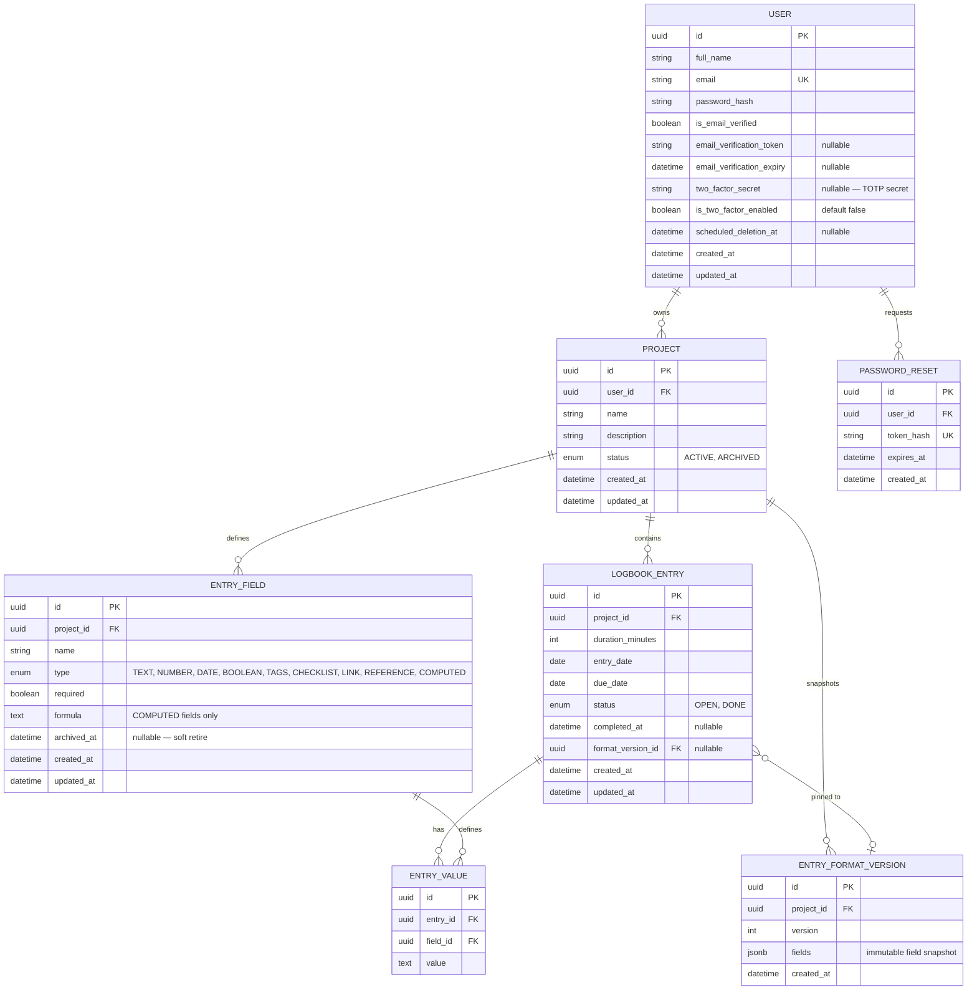

# Database Design

## Overview

The Digital Logbook uses a PostgreSQL database to store users, projects,
project entry formats, and logbook entries.

A key design goal was that different projects need different logbook
entry structures (e.g. one project may track "hours worked" and "task
completed", while another tracks "description" and "outcome"). Rather
than hardcoding a fixed set of columns for logbook entries, we adopted
an **Entity-Attribute-Value (EAV)** pattern using `ENTRY_FIELD` and
`ENTRY_VALUE`. This trades some query simplicity for the flexibility of
letting each project define its own entry format without requiring
schema changes.

We use **UUIDs** rather than auto-incrementing integers as primary keys
to avoid exposing sequential, guessable IDs and to make it easier to
merge or migrate data across environments without ID collisions.

## Entity Relationship Diagram

### Enums

| Enum | Values | Used by |
|---|---|---|
| `ProjectStatus` | `ACTIVE`, `ARCHIVED` | `projects.status` |
| `EntryFieldType` | `TEXT`, `NUMBER`, `DATE`, `BOOLEAN`, `TAGS`, `CHECKLIST`, `LINK`, `REFERENCE`, `COMPUTED` | `entry_fields.type` |
| `EntryStatus` | `OPEN`, `DONE` | `logbook_entries.status` |

### Constraints

- `USER.email` — Unique. Each email can only register once.
- `PROJECT(user_id, name)` — Unique. A student cannot have two projects with the same name.
- `ENTRY_VALUE(entry_id, field_id)` — Unique. One value per field per entry.
- `ENTRY_FORMAT_VERSION(project_id, version)` — Unique. Version numbers increment per project.
- All foreign keys use `ON DELETE CASCADE` for full account erasure, except `logbook_entries.format_version_id`, which uses `ON DELETE SET NULL` — deleting a snapshot must not destroy entries.

## Main Entities

### User

Represents a student using the Digital Logbook.

A user can have multiple projects and can request multiple password
resets over time.

Passwords are stored as a salted hash (`password_hash`), never as
plain text.

Authentication-related columns:

- `is_email_verified`, `email_verification_token`, `email_verification_expiry` — email ownership is proven before login is allowed. The token is 32 random bytes and expires after one hour.
- `two_factor_secret`, `is_two_factor_enabled` — optional TOTP two-factor authentication. The secret is staged at setup time and only becomes active (`is_two_factor_enabled = true`) after the user proves their authenticator works. Both columns are nullable / default-false, so they are fully backward compatible.
- `scheduled_deletion_at` — reserved for delayed account-deletion jobs.

See `apps/backend/AUTHENTICATION.md` in the repository for the full
authentication design.

### Project

Represents a separate project belonging to a student.

A project can contain multiple entry fields, format versions, and
logbook entries. Archiving sets `status = ARCHIVED`; entries stay
editable either way.

### Entry Field

Defines the structure of a project's logbook entries.

For example, a project could define fields such as:

- Description (TEXT)
- Date (DATE)
- Hours worked (NUMBER)
- Task completed (BOOLEAN)

`type` is enforced at the application layer when validating
`ENTRY_VALUE.value`, since the value itself is stored as a string to
support different field types.

Sprint 2 extended the field types beyond the basic four:

| Type | Meaning |
|---|---|
| `TAGS` | A list of short labels |
| `CHECKLIST` | A list of checkable items |
| `LINK` | A reference to another entry in the same project |
| `REFERENCE` | A reference to an entry in a different project |
| `COMPUTED` | A value derived from other fields via `formula` rather than typed in |

`archived_at` implements **soft retirement**: a field dropped from the
format stops appearing on new entry forms, but existing values remain
readable in old entries. `formula` is only populated for `COMPUTED`
fields and stores the expression the server evaluates on save.

### Entry Format Version

An **immutable snapshot** of a project's entry format, taken whenever
the format changes (field added, dropped, renamed, or re-typed).

This is what keeps historical entries readable: each entry pins the
format version that was current when it was created
(`format_version_id`), so later format changes never break old entries.
Changing a format creates a new snapshot and carries existing entries
forward — filling in what it reasonably can — rather than abandoning
them.

The snapshot itself is stored as `JSONB` (`fields`), which keeps the
whole field definition set together and queryable.

### Logbook Entry

Represents a recorded activity within a project.

An entry stores the date it was recorded (`entry_date`, user-editable
for backdating), the amount of time spent (`duration_minutes`), an
optional deadline (`due_date`), and its completion state:

- `status` — `OPEN` (work still to do) or `DONE`.
- `completed_at` — timestamp set when the entry is marked done.

Open entries with past due dates surface automatically in the Overdue
view and the Open Work page's due-date buckets.

### Entry Value

Stores the value entered for a particular field of a particular
logbook entry.

This allows different projects to have different entry structures.

### Password Reset

Stores a password-reset request for a user. Each record contains a
unique, time-limited token sent to the user's email, and an
`expires_at` timestamp so that reset links become invalid after a
short period. Tokens are single-use: all of a user's reset records are
deleted in the same transaction that updates the password. This
supports the **US00.3 – Reset Password** user story defined in the
Development Plan.

## Schema Changes Over Time

### How changes are applied

During development the schema is managed with **`npx prisma db push`**
(schema → database, no migration history). The single committed SQL
migration, `prisma/migrations/20260908000000_entry_format_versions.sql`,
documents the Sprint 2 schema change that introduced rich field types,
soft-retired fields, and entry-format snapshots; it is written
idempotently (`IF NOT EXISTS`) so it can be re-run safely.

### Deployment

The database is a managed **PostgreSQL instance hosted on [Neon](https://neon.tech)**
(serverless, autoscaling). The backend connects with Prisma's driver
adapter using the `DATABASE_URL` environment variable; connection
strings never leave the environment configuration.

### Change history

| Change | Sprint | Tables affected |
|---|---|---|
| Initial schema (users, projects, entry fields, entries, entry values, password resets) | 1 | all |
| Email verification + 2FA columns | 1 | `users` |
| Rich field types, `formula`, `archived_at` | 2 | `entry_fields` |
| Entry format versioning (`entry_format_versions`, `format_version_id`) | 2 | new table + `logbook_entries` |
| Entry status tracking (`status`, `completed_at`) | 2 | `logbook_entries` |

The authoritative source for the current schema is
`apps/backend/prisma/schema.prisma` in the repository.
