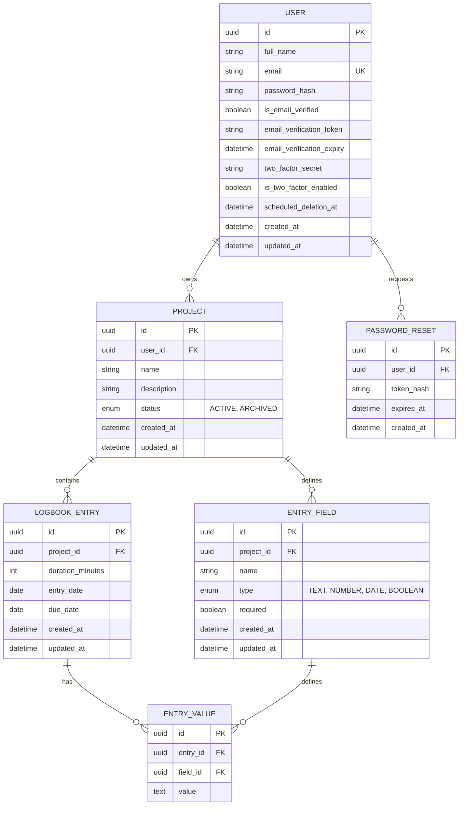

# Database Design

## Entity Relationship Diagram

The Digital Logbook uses a PostgreSQL database to store users, projects,
project entry formats, and logbook entries.

### Constraints

- `USER.email` — Unique. Each email can only register once.
- `PROJECT(user_id, name)` — Unique. A student cannot have two projects with the same name.
- `ENTRY_VALUE(entry_id, field_id)` — Unique. One value per field per entry.
- All foreign keys use `ON DELETE CASCADE` for full account erasure.

## Main Entities

### User

Represents a student using the Digital Logbook.

A user can have multiple projects.

### Project

Represents a separate project belonging to a student.

A project can contain multiple entry fields and logbook entries.

### Entry Field

Defines the structure of a project's logbook entries.

For example, a project could define fields such as:

- Description
- Date
- Hours worked
- Task completed

Different projects can have different entry formats.

### Logbook Entry

Represents a recorded activity within a project.

An entry stores information such as the date it was recorded and the amount of
time spent.

### Entry Value

Stores the value entered for a particular field of a particular logbook entry.

This allows different projects to have different entry structures.