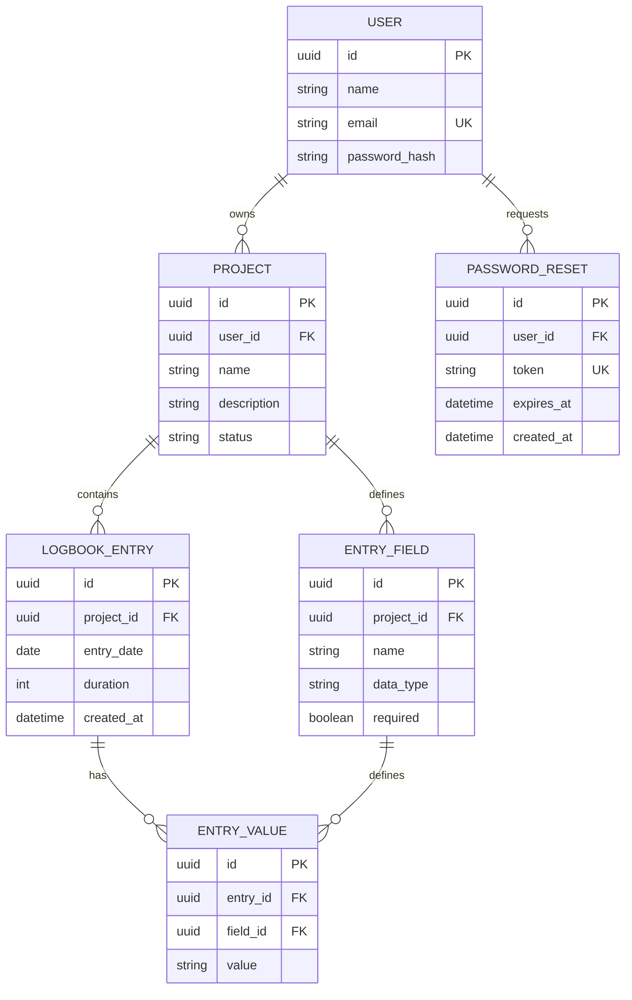

# Database Design

## Overview

The Digital Logbook uses a PostgreSQL database to store users, projects,
project entry formats, and logbook entries.

A key design goal was that different projects need different logbook
entry structures (e.g. one project may track "hours worked" and "task
completed", while another tracks "description" and "outcome"). Rather
than hardcoding a fixed set of columns for logbook entries, we adopted
an **Entity-Attribute-Value (EAV)** pattern using `ENTRY_FIELD` and
`ENTRY_VALUE`. This trades some query simplicity for the flexibility of
letting each project define its own entry format without requiring
schema changes.

We use **UUIDs** rather than auto-incrementing integers as primary keys
to avoid exposing sequential, guessable IDs and to make it easier to
merge or migrate data across environments without ID collisions.

## Entity Relationship Diagram

## Main Entities

### User

Represents a student using the Digital Logbook.

A user can have multiple projects and can request multiple password
resets over time.

Passwords are stored as a salted hash (`password_hash`), never as
plain text.

### Project

Represents a separate project belonging to a student.

A project can contain multiple entry fields and logbook entries.

### Entry Field

Defines the structure of a project's logbook entries.

For example, a project could define fields such as:

- Description
- Date
- Hours worked
- Task completed

`data_type` (e.g. `text`, `number`, `date`, `boolean`) is enforced at
the application layer when validating `ENTRY_VALUE.value`, since the
value itself is stored as a string to support different field types.

Different projects can have different entry formats.

### Logbook Entry

Represents a recorded activity within a project.

An entry stores information such as the date it was recorded and the
amount of time spent.

### Entry Value

Stores the value entered for a particular field of a particular
logbook entry.

This allows different projects to have different entry structures.

### Password Reset

Stores a password-reset request for a user. Each record contains a
unique, time-limited `token` sent to the user's email, and an
`expires_at` timestamp so that reset links become invalid after a
short period. This supports the **US00.3 – Reset Password** user
story defined in the Development Plan.