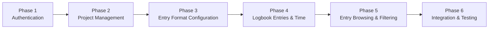
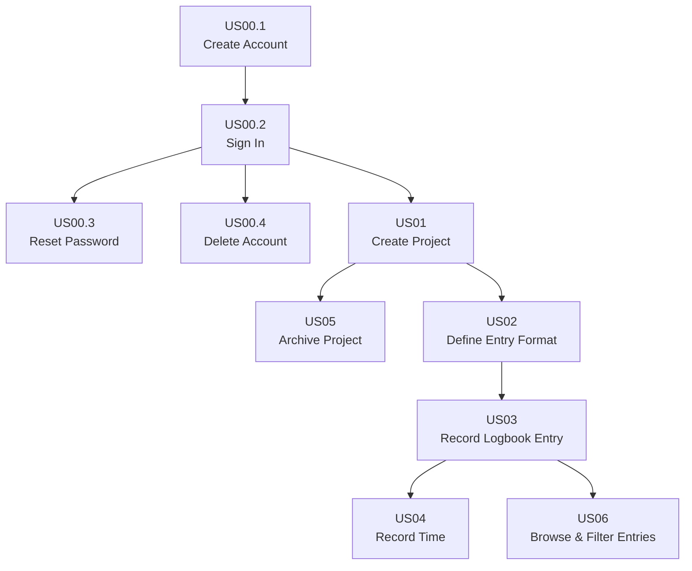

# Development Plan

## Overview

Development of the Digital Logbook will follow a structured, dependency-driven approach. User stories will be implemented in groups based on the functionality they provide and the dependencies between them.

The development sequence begins with authentication and account management, followed by project management, entry format configuration, logbook entry creation, and entry browsing. Integration and testing will then be used to verify that the complete system satisfies the defined acceptance criteria.

## Development Approach

Development will be carried out incrementally. Each development phase will produce a functional part of the system that can be integrated with the functionality developed in previous phases.

The main principles are:

* Implement foundational functionality before dependent functionality.
* Develop related user stories together where they share functionality.
* Use the database design and system architecture as the basis for implementation.
* Test functionality against its user-story acceptance criteria.
* Integrate frontend, backend, and database components throughout development.
* Preserve existing project and entry data when implementing operations such as project archiving.

## Development Sequence

The planned development sequence is:

The sequence reflects the dependencies between the user stories. For example, a project must exist before an entry format can be defined for it, and an entry format must exist before a project-specific logbook entry can be created.

## Phase 1 — Authentication and Account Management

### User Stories

* **US00.1 – Create an Account**
* **US00.2 – Sign In**
* **US00.3 – Reset Password**
* **US00.4 – Delete Account**

### Development Work

The first phase establishes the account and authentication functionality required to associate logbook data with individual students.

Development will include:

* Creating the account registration interface.
* Validating registration information.
* Preventing duplicate accounts.
* Implementing secure authentication.
* Associating authenticated users with their projects and entries.
* Implementing password-reset functionality.
* Implementing account deletion and the required data-deletion behaviour.
* Protecting authenticated application functionality from unauthorised access.

### Dependencies

US00.1 and US00.2 form the foundation for the remaining authentication functionality. Password reset and account deletion require an existing account and authentication infrastructure.

### Deliverable

A student can create an account, sign in securely, reset their password, and delete their account.

---

## Phase 2 — Project Management

### User Stories

* **US01 – Create a Project**
* **US05 – Archive a Project**

### Development Work

This phase introduces project management functionality.

Development will include:

* Creating projects with a name and optional description.
* Associating projects with the authenticated student.
* Displaying projects in the student's project list.
* Setting newly created projects as active.
* Implementing project archiving.
* Separating active and archived projects in the interface.
* Ensuring that archiving a project does not delete its entries or historical data.

### Dependencies

Projects depend on authentication because each project must belong to a student.

US05 depends on the basic project functionality implemented for US01.

### Deliverable

A student can create and manage projects, archive completed projects, and retain access to their historical project information.

---

## Phase 3 — Entry Format Configuration

### User Story

* **US02 – Define a Project's Entry Format**

### Development Work

This phase implements the custom entry structure for each project.

Development will include:

* Providing an interface for defining entry fields.
* Allowing the student to add fields to a project.
* Allowing field names to be specified.
* Allowing the value type of each field to be selected.
* Associating entry fields with their project.
* Persisting entry-format definitions in the database.
* Ensuring that different projects can have different entry formats.

### Dependencies

US02 depends on US01 because an entry format must be associated with an existing project.

The resulting entry format is also a direct dependency for US03 because the entry creation form must use the fields defined for the selected project.

### Deliverable

A student can configure a custom entry format for each project.

---

## Phase 4 — Logbook Entry Creation and Time Tracking

### User Stories

* **US03 – Record a Logbook Entry**
* **US04 – Record Time Spent on an Entry**

### Development Work

This phase implements the core logbook functionality.

Development will include:

* Allowing the student to select a project when creating an entry.
* Dynamically displaying the fields defined by that project's entry format.
* Validating entered field values.
* Saving logbook entries to the database.
* Recording the entry creation time.
* Associating each entry with the selected project.
* Allowing the student to record the time spent on an activity.
* Persisting recorded time with the entry.
* Calculating or updating the project's total recorded time.

### Dependencies

US03 depends on US01 and US02 because an entry requires an existing project and its entry format.

US04 extends US03 because time spent is recorded as part of a logbook entry.

### Deliverable

A student can create project-specific logbook entries using the configured entry format and record the time spent on each entry.

---

## Phase 5 — Entry Browsing and Filtering

### User Story

* **US06 – Browse and Filter My Entries**

### Development Work

This phase provides functionality for reviewing recorded work.

Development will include:

* Displaying the student's logbook entries.
* Ordering entries chronologically.
* Displaying the project associated with each entry.
* Allowing entries to be filtered by project.
* Providing an entry detail view.
* Ensuring that filtering only changes how entries are displayed and does not modify stored data.

### Dependencies

US06 depends on the existence of logbook entries created through US03.

### Deliverable

A student can browse their recorded entries, filter them by project, and view individual entry information.

---

## Phase 6 — Integration, Testing and Refinement

### Development Work

The final development phase focuses on integrating the individual features into a complete application and verifying that the system satisfies the requirements.

Development will include:

* Integrating frontend, backend, and database functionality.
* Testing API interactions between the frontend and backend.
* Testing database relationships and data persistence.
* Testing authentication and access control.
* Testing each user story against its acceptance criteria.
* Testing interactions between projects, entry formats, and logbook entries.
* Testing project archiving without loss of historical data.
* Validating form input and handling invalid data.
* Handling application and API errors.
* Testing responsive layouts and common user interactions.
* Fixing defects identified during testing.
* Performing final usability and consistency checks.

### Deliverable

A fully integrated Digital Logbook that satisfies the acceptance criteria for all defined user stories and preserves the relationships between users, projects, entry formats, and logbook entries.

## User Story Dependencies

The main dependencies between the user stories are:

These dependencies describe the logical order of implementation rather than requiring every user story to be completed independently before work on another story can begin.

## Testing Strategy

Each user story will be tested against its acceptance criteria after implementation.

Testing will include:

| Testing Area       | Purpose                                                                     |
| ------------------ | --------------------------------------------------------------------------- |
| Authentication     | Verify account creation, sign-in, password reset and account deletion       |
| Project Management | Verify project creation, ownership and archiving                            |
| Entry Formats      | Verify that project-specific fields can be created and stored               |
| Logbook Entries    | Verify that entries use the correct project entry format                    |
| Time Tracking      | Verify that recorded time is stored and associated with the correct project |
| Entry Browsing     | Verify chronological display, filtering and entry details                   |
| Integration        | Verify that frontend, backend and database components work together         |
| Validation         | Verify that invalid or incomplete input is handled correctly                |
| Regression Testing | Ensure new functionality does not break existing functionality              |

## Definition of Done

A user story will be considered complete when:

* Its acceptance criteria have been implemented.
* The required frontend functionality is available.
* The required backend functionality is implemented.
* Data is correctly persisted in the database where applicable.
* Input validation and relevant error handling are implemented.
* The functionality has been tested successfully.
* The implementation integrates correctly with existing functionality.
* No known critical defects remain for the user story.

The development plan therefore progresses from foundational account functionality to project management, configurable entry formats, logbook recording, and finally entry review and system-wide integration. This order ensures that each major feature is built on the functionality required by its dependencies.
