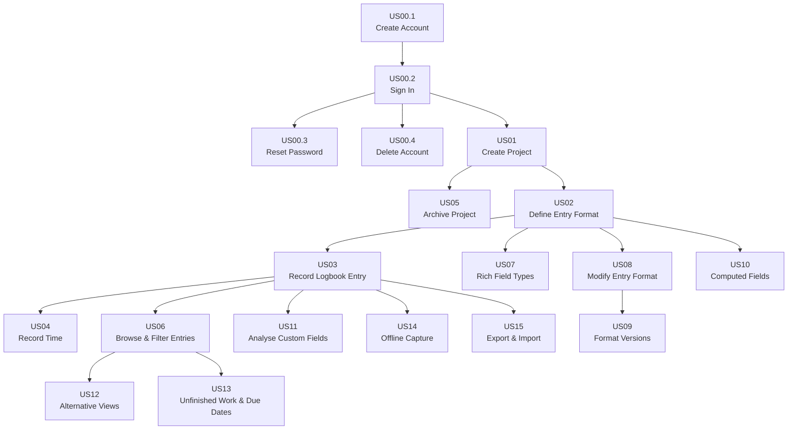
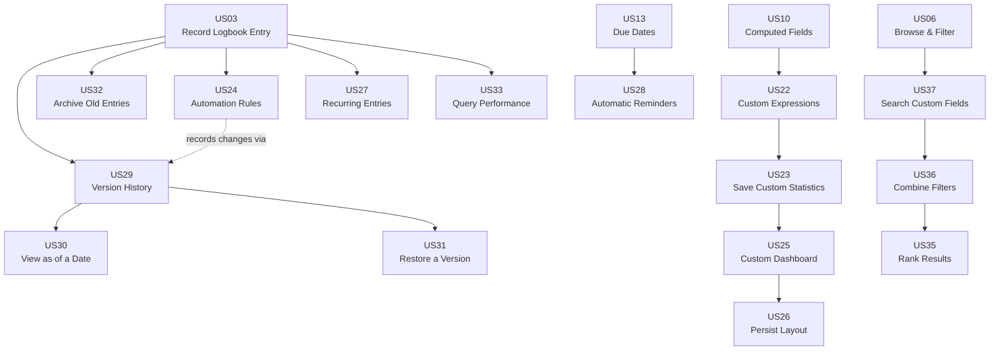

# Development Plan

## Overview

Development of the Digital Logbook follows a structured, dependency-driven approach. User stories are implemented in groups based on the functionality they provide and the dependencies between them.

The development sequence began with authentication and account management, followed by project management, entry format configuration, logbook entry creation, entry browsing, and integration and testing. The Intermediate phase extended the Basic functionality with richer field types, entry-format versioning, computed fields, custom-field analysis, alternative views, unfinished-work tracking, offline capture, and data export/import. The Advanced phase (Sprint 3) added owner-defined statistics, a personal dashboard, automation, a full record history, and search and performance work for long-lived logbooks.

Development was carried out incrementally, with each phase producing functionality that could be integrated with the functionality developed in previous phases.

---

## Development Approach

Development was carried out incrementally using the following principles:

* Implement foundational functionality before dependent functionality.
* Develop related user stories together where they share functionality.
* Use the database design and system architecture as the basis for implementation.
* Test functionality against its user-story acceptance criteria.
* Integrate frontend, backend, and database components throughout development.
* Preserve existing project and entry data when implementing operations such as project archiving.
* Extend existing functionality rather than unnecessarily duplicating functionality.
* Test new Intermediate functionality together with the existing Basic functionality to identify integration and regression issues.
* Record every change to an entry, so that later features (history, restore, automation) can rely on it and no correction loses data.

The project continued to use the Gitea Kanban board, Issues, Labels, Milestones, branches, and pull requests to track development.

---

## Development Sequence

The overall development sequence was:

```mermaid
flowchart LR

    A["Phase 1<br/>Authentication"] --> B["Phase 2<br/>Project Management"]

    B --> C["Phase 3<br/>Entry Format Configuration"]

    C --> D["Phase 4<br/>Logbook Entries & Time"]

    D --> E["Phase 5<br/>Entry Browsing & Filtering"]

    E --> F["Phase 6<br/>Integration & Testing"]

    F --> G["Phase 7<br/>Intermediate Features"]

    G --> H["Phase 8<br/>Intermediate Integration & Testing"]

    H --> I["Phase 9<br/>Advanced Features (Sprint 3)"]

    I --> J["Phase 10<br/>Advanced Integration & Testing"]
```

The sequence reflects the dependencies between the user stories. For example, a project must exist before an entry format can be defined for it, and an entry format must exist before a project-specific logbook entry can be created.

The Intermediate phase builds on the completed Basic functionality rather than replacing it, and the Advanced phase builds on both.

---

# Basic Development Phase

## Phase 1 — Authentication and Account Management

### User Stories

* **US00.1 – Create an Account**
* **US00.2 – Sign In**
* **US00.3 – Reset Password**
* **US00.4 – Delete Account**

### Development Work

This phase established the account and authentication functionality required to associate logbook data with individual students.

Development included:

* Creating the account registration interface.
* Validating registration information.
* Preventing duplicate accounts.
* Implementing secure authentication.
* Associating authenticated users with their projects and entries.
* Implementing password-reset functionality.
* Implementing account deletion and the required data-deletion behaviour.
* Protecting authenticated application functionality from unauthorised access.

### Dependencies

US00.1 and US00.2 formed the foundation for the remaining authentication functionality. Password reset and account deletion depend on the account and authentication infrastructure.

### Deliverable

A student can create an account, sign in, reset their password, and delete their account.

---

## Phase 2 — Project Management

### User Stories

* **US01 – Create a Project**
* **US05 – Archive a Project**

### Development Work

This phase introduced project management functionality.

Development included:

* Creating projects with a name and optional description.
* Associating projects with the authenticated student.
* Displaying projects in the student's project list.
* Setting newly created projects as active.
* Implementing project archiving.
* Separating active and archived projects in the interface.
* Ensuring that archiving a project does not delete its entries or historical data.
* Supporting project unarchiving.

### Dependencies

Projects depend on authentication because each project belongs to a student.

US05 extends the project functionality implemented for US01.

### Deliverable

A student can create and manage projects, archive completed projects, and retain access to their historical project information.

---

## Phase 3 — Entry Format Configuration

### User Story

* **US02 – Define a Project's Entry Format**

### Development Work

This phase implemented the custom entry structure for each project.

Development included:

* Providing an interface for defining entry fields.
* Allowing students to add fields to a project.
* Allowing field names to be specified.
* Allowing the value type of each field to be selected.
* Associating entry fields with their project.
* Persisting entry-format definitions in the database.
* Ensuring that different projects can have different entry formats.

### Dependencies

US02 depends on US01 because an entry format must be associated with an existing project.

The resulting entry format is a direct dependency for US03 because the entry creation form uses the fields defined for the selected project.

### Deliverable

A student can configure a custom entry format for each project.

---

## Phase 4 — Logbook Entry Creation and Time Tracking

### User Stories

* **US03 – Record a Logbook Entry**
* **US04 – Record Time Spent on an Entry**

### Development Work

This phase implemented the core logbook functionality.

Development included:

* Allowing the student to select a project when creating an entry.
* Dynamically displaying the fields defined by that project's entry format.
* Validating entered field values.
* Saving logbook entries to the database.
* Recording entry dates and creation information.
* Associating each entry with the selected project.
* Allowing students to record time spent on an activity.
* Persisting recorded time with the entry.
* Supporting live time tracking.
* Supporting due dates and overdue identification.
* Calculating or updating project-level recorded time.

### Dependencies

US03 depends on US01 and US02 because an entry requires an existing project and its entry format.

US04 extends US03 because time spent is recorded as part of a logbook entry.

### Deliverable

A student can create project-specific logbook entries using the configured entry format and record the time spent on each entry.

---

## Phase 5 — Entry Browsing and Filtering

### User Story

* **US06 – Browse and Filter My Entries**

### Development Work

This phase provided functionality for reviewing recorded work.

Development included:

* Displaying the student's logbook entries.
* Ordering entries chronologically.
* Displaying the project associated with each entry.
* Allowing entries to be filtered by project.
* Providing an entry detail view.
* Supporting identification of overdue entries.
* Ensuring that filtering only changes how entries are displayed and does not modify stored data.

### Dependencies

US06 depends on the existence of logbook entries created through US03.

### Deliverable

A student can browse their recorded entries, filter them by project, and view individual entry information.

---

## Phase 6 — Basic Integration, Testing and Refinement

### Development Work

This phase focused on integrating the Basic functionality into a complete application and verifying that the system satisfied the requirements.

Development included:

* Integrating frontend, backend, and database functionality.
* Testing API interactions between the frontend and backend.
* Testing database relationships and data persistence.
* Testing authentication and access control.
* Testing user stories against their acceptance criteria.
* Testing interactions between projects, entry formats, and logbook entries.
* Testing project archiving without loss of historical data.
* Validating form input and handling invalid data.
* Handling application and API errors.
* Testing responsive layouts and common user interactions.
* Fixing defects identified during testing.
* Performing usability and consistency checks.

### Deliverable

An integrated Basic Digital Logbook supporting authentication, project management, custom entry formats, logbook entries, time tracking, and entry browsing.

---

# Intermediate Development Phase

## Phase 7 — Intermediate Functionality

The Intermediate phase extended the Basic Digital Logbook with additional customisation, analysis, organisation, offline, and data-management functionality.

### User Stories

* **US07 – Rich Field Types**
* **US08 – Modify Existing Entry Format**
* **US09 – Preserve Previous Entry Format Versions**
* **US10 – Computed Fields**
* **US11 – Analyse Custom Fields**
* **US12 – Alternative Views**
* **US13 – Unfinished Work and Due Dates**
* **US14 – Capture Entries Offline**
* **US15 – Export and Import Logbook Data**

### Development Work

Development included the following functionality.

### US07 — Rich Field Types

The entry-format functionality was extended to support richer types of custom fields beyond the original basic field configuration.

This allows project entry formats to better represent the type of information students need to record.

### US08 — Modify Existing Entry Format

Existing project entry formats can be modified after they have been created.

The entry-format interface was extended to support changes to the structure of project entries while maintaining the relationship between projects and their entry formats.

### US09 — Preserve Previous Entry Format Versions

Entry-format changes were implemented with consideration for previously recorded entries.

Previous format information is preserved so that modifying the format does not unnecessarily invalidate historical logbook data.

### US10 — Computed Fields

Computed fields were introduced to allow supported fields to derive values from other entry information.

This extends the entry format from a purely data-capture structure into a structure that can also provide calculated information.

### US11 — Analyse Custom Fields

The application was extended to provide statistics and analysis based on custom entry fields.

This provides students with additional ways to understand information recorded in their logbook rather than only displaying individual entries.

### US12 — Alternative Views

Alternative ways of viewing entries were introduced to make recorded work easier to organise and review.

These views complement the existing chronological and project-filtered entry browsing functionality.

### US13 — Unfinished Work and Due Dates

The application supports tracking unfinished work and due dates.

Development included functionality for identifying work that has not been completed and distinguishing entries based on their deadline status.

This builds on the due-date functionality established during the Basic development.

### US14 — Capture Entries Offline

Offline capture functionality was introduced so that students can record logbook information when a connection is temporarily unavailable.

Offline information can be retained and synchronised when connectivity becomes available.

### US15 — Export and Import Logbook Data

The application supports exporting and importing logbook data.

This provides students with a way to retain, transfer, or restore their logbook information without directly accessing the database.

### Dependencies

The Intermediate functionality builds on the Basic functionality.

The main dependencies are:

* US07 depends on the existing custom entry-format functionality from US02.
* US08 and US09 depend on the existing entry-format and entry data structures.
* US10 depends on the custom field structure and entry data.
* US11 depends on stored custom-field and entry data.
* US12 and US13 extend the existing entry browsing and due-date functionality.
* US14 extends the existing entry-creation functionality.
* US15 operates on the existing project and entry data.

### Deliverable

The Digital Logbook supports the completed Intermediate functionality while retaining the Basic functionality developed previously.

---

## Phase 8 — Intermediate Integration, Testing and Refinement

### Development Work

The final Intermediate phase focused on integrating the additional functionality with the existing application.

Development and testing included:

* Integrating Intermediate frontend functionality with the existing application.
* Integrating Intermediate backend functionality with the existing database structure.
* Testing interactions between Basic and Intermediate features.
* Testing modified entry formats with existing project and entry data.
* Testing alternative entry views.
* Testing unfinished and overdue work.
* Testing offline capture and synchronisation.
* Testing export and import functionality.
* Testing custom-field analysis and computed fields.
* Testing validation and error handling.
* Performing regression testing against previously implemented functionality.
* Fixing integration defects identified during development.
* Reviewing the consistency of the user interface across the expanded application.

### Documentation and Deployment

The project documentation was also made available online during this phase.

The MkDocs documentation site was deployed using Netlify, and a link to the deployed documentation was added to the project's `README.md`.

### Deliverable

A fully integrated Digital Logbook containing the Basic and Intermediate functionality, supported by project documentation and testing.

---

# Advanced Development Phase (Sprint 3)

## Phase 9 — Advanced Functionality

The Advanced phase answers the brief's request for a logbook that computes over data whose shape only its owner knows, keeps its record hard to lose, does some of the writing itself, and stays quick after years of use. The sixteen stories were tracked as Gitea issues #94–#109 under the `Sprint 3 - Advanced Logbook` milestone and divided into four functional areas.

### User Stories

| Area | Stories | Board status |
|---|---|---|
| Custom Statistics & Expressions | US22 Define Custom Expressions, US23 Save Custom Statistics, US24 Entry Automation Rules | Done |
| Personal Dashboard & Automation | US25 Create a Custom Dashboard, US26 Arrange and Persist Dashboard Layout, US27 Create Recurring Entries, US28 Generate Automatic Reminders | Done |
| Versioning & Record History | US29 Preserve Entry Version History, US30 View an Entry as It Existed on a Given Date, US31 Restore a Previous Entry Version, US32 Archive Old Entries | Done |
| Advanced Search & Performance | US33 Maintain Query Performance for Large Logbooks, US34 Apply Rules When Capturing Entries (same story as US24), US35 Rank Search Results by Relevance, US36 Combine Search Filters, US37 Search Custom Fields | Done |

### Custom Statistics & Expressions

**US22 — Define Custom Expressions.** A student writes an expression such as `SUM({Hours}) / COUNT()` over a project's entries. The server parses and evaluates it itself; no user input is ever executed, and field names reach the database only as bound parameters after being matched against the project's own fields.

**US23 — Save Custom Statistics.** An expression can be saved with a name and appears alongside the built-in statistics. Only the definition is stored, so the value always reflects the current entries.

**US24 — Entry Automation Rules.** A rule watches a project's entries and adds or removes a tag or sets the status when its conditions hold. Rules run after the entry is saved, cannot trigger themselves or each other, and a broken rule is skipped rather than failing the save.

### Personal Dashboard & Automation

**US25 — Create a Custom Dashboard.** The student chooses which statistics and information panels to show, including their saved statistics.

**US26 — Arrange and Persist Dashboard Layout.** The chosen panels and their order are stored on the server, so the same dashboard appears on every device.

**US27 — Create Recurring Entries.** An entry can repeat daily, weekly or monthly. Occurrences are generated from a stored template, both by a background job and when entries are read, so none are missed while the server sleeps.

**US28 — Generate Automatic Reminders.** Reminders are raised for entries due soon, overdue entries, entries left untouched, and a daily prompt when nothing has been logged, alongside reminders the student sets by hand. They are delivered as web push notifications when the logbook is closed.

### Versioning & Record History

**US29 — Preserve Entry Version History.** Every create, edit, status change, restore and automated change writes an immutable snapshot of the entry.

**US30 — View an Entry as It Existed on a Given Date.** The newest version at or before a chosen date is shown.

**US31 — Restore a Previous Entry Version.** An earlier version becomes current again. The restore is itself saved as a new version, so nothing is lost by restoring.

**US32 — Archive Old Entries.** Old entries move to an archive that keeps them but leaves them out of the default views.

### Advanced Search & Performance

**US33 — Maintain Query Performance for Large Logbooks.** Database indexes on the columns common queries filter by, a paginated Entries page, and a single request for open work instead of one per project.

**US34 — Apply Rules When Capturing Entries.** Overlaps with US24, whose rule engine already applies rules when an entry is captured.

**US35–US37 — Search.** Searching inside specific custom fields, combining several filters in one search, and ranking results by relevance rather than by date.

### Dependencies

* US22 depends on the custom fields and entry values from US02, US03 and US10.
* US23 depends on US22, and US25 depends on US23 to offer saved statistics as panels. US26 extends US25.
* US24 depends on the entry-save path from US03 and on tags; its changes are recorded through US29.
* US27 depends on entry creation (US03); US28 depends on due dates (US13) and entry status.
* US30 and US31 depend on the version history from US29.
* US32 and US33 apply across all entry features; US35–US37 depend on custom fields (US02) and the existing browsing and filtering (US06).

### Deliverable

A logbook whose owner can compute over their own data, arrange their own dashboard, have entries and reminders generated for them, and see and restore any past state of an entry.

---

## Phase 10 — Advanced Integration, Testing and Refinement

### Development Work

* Testing each Advanced story against its acceptance tests with backend integration tests and frontend tests.
* Testing that automation, recurrence and restores all write version history.
* Testing ownership: one student's statistics, rules, reminders, layouts and history cannot be read or changed by another.
* Testing that a broken automation rule or an unreadable statistic never costs the user an entry or a whole page.
* Testing push notifications against a production build, since the service worker is only registered there.
* Regression testing against the Basic and Intermediate functionality.

### Deliverable

The Advanced functionality integrated with the existing Digital Logbook, with all Sprint 3 stories complete.

---

# User Story Dependencies

The main dependencies between the Basic and Intermediate user stories are:

The Advanced stories build on those:

These dependencies describe the logical relationships between the user stories rather than requiring every story to be completed independently before work on another story can begin.

---

# Testing Strategy

Each user story was tested against its acceptance criteria after implementation.

Testing included:

| Testing Area          | Purpose                                                                                         |
| --------------------- | ----------------------------------------------------------------------------------------------- |
| Authentication        | Verify account creation, sign-in, password reset and account deletion                           |
| Project Management    | Verify project creation, ownership and archiving                                                |
| Entry Formats         | Verify that project-specific fields can be created, modified and stored                         |
| Rich Field Types      | Verify that supported field types behave correctly                                              |
| Entry Versions        | Verify that changes to formats preserve relevant historical information                         |
| Computed Fields       | Verify calculated field behaviour                                                               |
| Custom-Field Analysis | Verify statistics and analysis using custom entry data                                          |
| Logbook Entries       | Verify that entries use the correct project entry format                                        |
| Time Tracking         | Verify that recorded time is stored and associated with the correct project                     |
| Entry Browsing        | Verify chronological display, filtering and entry details                                       |
| Alternative Views     | Verify that entries can be represented using supported alternative views                        |
| Due Dates             | Verify unfinished and overdue work handling                                                     |
| Offline Capture       | Verify that entries can be captured without an active connection and synchronised appropriately |
| Export/Import         | Verify that logbook data can be exported and imported                                           |
| Custom Statistics     | Verify that expressions evaluate correctly, reject invalid input, and saved statistics follow the data |
| Dashboard             | Verify that chosen panels and their order persist per user across devices                       |
| Automation            | Verify that rules apply only when their conditions hold, never loop, and never lose an entry    |
| Recurrence & Reminders | Verify that occurrences and reminders are generated once, on time, and pushed to devices       |
| Record History        | Verify that every change is versioned, past states can be viewed, and restores are themselves recorded |
| Performance           | Verify that entry listings page correctly and common queries stay fast                          |
| Integration           | Verify that frontend, backend and database components work together                             |
| Validation            | Verify that invalid or incomplete input is handled correctly                                    |
| Regression Testing    | Ensure new functionality does not break existing functionality                                  |

Testing was performed throughout development rather than being limited to the final phase. This allowed defects in individual components and interactions between features to be identified and corrected during implementation.

---

# Definition of Done

A user story is considered complete when:

* Its acceptance criteria have been implemented.
* The required frontend functionality is available.
* The required backend functionality is implemented where applicable.
* Data is correctly persisted in the database where applicable.
* Input validation and relevant error handling are implemented.
* The functionality has been tested successfully.
* The implementation integrates correctly with existing functionality.
* New functionality does not introduce known critical regressions.
* The functionality is represented appropriately in the project documentation.

For the Intermediate phase, the Definition of Done also required the new functionality to work with the existing Basic Digital Logbook rather than functioning as isolated features. For the Advanced phase, it also required every resource to be checked against its owner, and every change to an entry to be recorded in its history.

---

# Development Summary

The Digital Logbook was developed incrementally from foundational functionality to more advanced features.

The Basic development established:

1. Authentication and account management.
2. Project management.
3. Custom project entry formats.
4. Logbook entry creation.
5. Time tracking.
6. Entry browsing and filtering.
7. Integration and testing.

The Intermediate development then extended the system with:

1. Rich field types.
2. Entry-format modification.
3. Entry-format version preservation.
4. Computed fields.
5. Custom-field analysis.
6. Alternative entry views.
7. Unfinished-work and due-date functionality.
8. Offline entry capture and synchronisation.
9. Data export and import.
10. Integration and regression testing.

The Advanced development (Sprint 3) then added:

1. Custom expressions and saved statistics.
2. Entry automation rules.
3. A personal dashboard that persists across devices.
4. Recurring entries.
5. Automatic reminders with push notifications.
6. Entry version history, viewing an entry as of a date, and restoring a version.
7. Query-performance work for large logbooks.
8. Archiving old entries.
9. Structured search: custom-field filters, combined filters and relevance ranking.

All Sprint 3 stories are complete.

This dependency-driven approach allowed each phase to build on previously completed functionality while reducing the risk of breaking existing project and entry data.

The development plan therefore reflects the progression from the foundational Digital Logbook requirements through the Intermediate functionality to the Advanced features, while maintaining the original system architecture and project structure.
