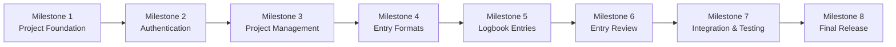

# Development Roadmap

## Overview

The Digital Logbook will be developed incrementally through a series of milestones. Each milestone builds on the functionality established in the previous milestone, allowing the system to progress from the initial project foundation to a complete and tested application.

The roadmap provides a high-level view of the project's development progression, while the Development Plan defines the specific user stories and dependencies within each stage.

## Roadmap

## Milestone 1 — Project Foundation

### Objectives

Establish the technical foundation required for development.

### Activities

* Set up the project repository and development structure.
* Configure the frontend application.
* Configure the backend API.
* Set up the PostgreSQL database.
* Establish the database schema.
* Configure communication between the frontend and backend.
* Establish environment configuration.
* Configure the development and testing environment.

### Outcome

The project has a functioning development environment with the main application components connected and ready for feature development.

---

## Milestone 2 — Authentication

### User Stories

* US00.1 – Create an Account
* US00.2 – Sign In
* US00.3 – Reset Password
* US00.4 – Delete Account

### Objectives

Implement the account and authentication functionality required to provide each student with a personal logbook.

### Outcome

Students can create and manage accounts and securely access their personal logbook.

---

## Milestone 3 — Project Management

### User Stories

* US01 – Create a Project
* US05 – Archive a Project

### Objectives

Implement the project functionality used to organise a student's logbook.

### Activities

* Create projects.
* Display projects.
* Associate projects with users.
* Manage project status.
* Archive completed projects.
* Preserve archived project records and entries.

### Outcome

Students can create projects and manage their active and archived projects.

---

## Milestone 4 — Entry Format Configuration

### User Story

* US02 – Define a Project's Entry Format

### Objectives

Implement custom entry structures so that each project can define the information recorded in its logbook entries.

### Activities

* Create entry fields.
* Define field names.
* Define field value types.
* Associate fields with projects.
* Store entry-format definitions.

### Outcome

Each project can have its own configurable entry format.

---

## Milestone 5 — Logbook Entry Recording

### User Stories

* US03 – Record a Logbook Entry
* US04 – Record Time Spent on an Entry

### Objectives

Implement the core functionality for recording work performed on projects.

### Activities

* Create project-specific entry forms.
* Display fields according to the selected project's entry format.
* Validate entry values.
* Save entries.
* Record entry creation time.
* Record time spent.
* Associate recorded time with the relevant project.

### Outcome

Students can record their work and the time spent on project activities.

---

## Milestone 6 — Entry Review

### User Story

* US06 – Browse and Filter My Entries

### Objectives

Provide students with an effective way to review previously recorded work.

### Activities

* Display entries chronologically.
* Display associated projects.
* Filter entries by project.
* View individual entry details.
* Ensure filtering does not modify stored data.

### Outcome

Students can easily review and locate their previous logbook entries.

---

## Milestone 7 — Integration and Testing

### Objectives

Bring all implemented functionality together and verify that the system operates correctly as a complete application.

### Activities

* Integrate frontend and backend features.
* Verify database persistence.
* Test user authentication and access control.
* Test user stories against their acceptance criteria.
* Test interactions between projects, entry formats and entries.
* Test archived projects and historical entries.
* Test validation and error handling.
* Perform regression testing.
* Fix identified defects.
* Perform responsive and usability testing.

### Outcome

The major system functionality is integrated and verified against the project's requirements.

---

## Milestone 8 — Final Release

### Objectives

Prepare the Digital Logbook for final submission or deployment.

### Activities

* Resolve remaining critical defects.
* Perform final acceptance testing.
* Review the user interface for consistency.
* Verify documentation.
* Verify database configuration.
* Verify application build and deployment configuration.
* Confirm that all required user stories are implemented.
* Prepare the final version of the system.

### Outcome

A complete Digital Logbook is ready for final demonstration, submission, or deployment.

## Roadmap Summary

| Milestone | Main Focus            | User Stories / Work                 |
| --------- | --------------------- | ----------------------------------- |
| **1**     | Project Foundation    | Application, API and database setup |
| **2**     | Authentication        | US00.1 – US00.4                     |
| **3**     | Project Management    | US01, US05                          |
| **4**     | Entry Formats         | US02                                |
| **5**     | Logbook Entries       | US03, US04                          |
| **6**     | Entry Review          | US06                                |
| **7**     | Integration & Testing | All user stories                    |
| **8**     | Final Release         | Final validation and deployment     |

## Roadmap Completion Criteria

The roadmap will be considered complete when:

* All defined user stories have been implemented.
* User-story acceptance criteria have been satisfied.
* Frontend, backend and database components operate together.
* User data is correctly associated with projects and entries.
* Project-specific entry formats function correctly.
* Logbook entries and recorded time are persisted correctly.
* Archived projects retain their historical information.
* Entries can be browsed and filtered.
* Testing has been completed and critical defects resolved.
* The application and supporting documentation are ready for final delivery.
