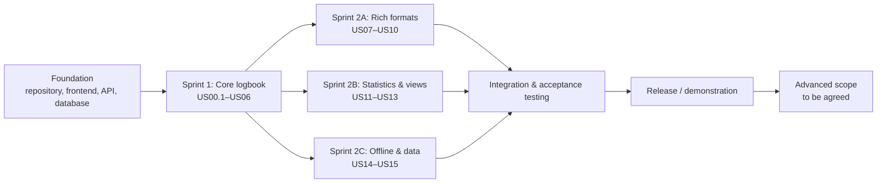
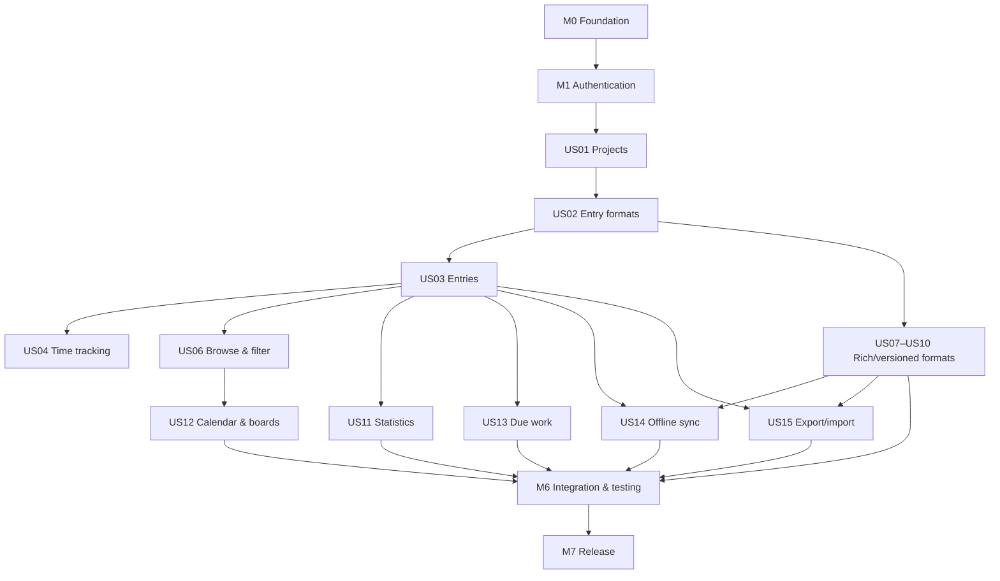

# Digital Logbook Roadmap

## Purpose and scope

This roadmap is the delivery plan for the Digital Logbook. It connects the
product brief to the user stories, team work areas, dependencies, testing and
release activities. A milestone is only complete when its acceptance tests pass
in the integrated application.

The agreed scope contains the Basic user stories (US00.1–US06) and
Intermediate user stories (US07–US15). The brief names an **Advanced** section,
but provides no Advanced user stories; that scope must be agreed before it is
scheduled.

## Delivery at a glance

## Milestones and status

| Milestone | Scope | Owner / work area | Status | Completion evidence |
| --- | --- | --- | --- | --- |
| M0 – Foundation | Monorepo, React frontend, Express API, Prisma/Neon database, documentation and build tooling | Whole team | Complete | Apps build and the local development environment runs |
| M1 – Accounts | US00.1–US00.4: register, sign in, reset password, delete account | Whole team | Complete | Authentication acceptance tests pass |
| M2 – Core logbook | US01–US06: projects, formats, entries, time, archiving, browsing/filtering | Whole team | Complete, subject to regression testing | Core acceptance tests pass |
| M3 – Rich entry formats | US07–US10: rich fields, editable/versioned formats, computed fields | Person 1 | Implemented; acceptance testing in progress | Rich-field, format-history and computed-field tests pass |
| M4 – Statistics and views | US11–US13: custom-field analysis, calendar/board views, due/unfinished work | Person 2 | In progress | Statistics, view and due-date acceptance tests pass |
| M5 – Resilience and portability | US14–US15: offline capture/sync, export/import | Person 3 | In progress | Offline/reconnect and backup/restore tests pass |
| M6 – Integration and quality | Cross-feature integration, regression, responsive and usability testing | Person 4 with all members | Planned / ongoing alongside M3–M5 | Test results, defect fixes and a clean build |
| M7 – Release | Deployment check, documentation, final demonstration and submission | Whole team | Planned | All required acceptance tests pass and no critical defects remain |

## Detailed plan

### M0 – Project foundation

**Goal:** establish a reliable technical base before feature work begins.

- Set up the monorepo and shared TypeScript types.
- Configure React/Vite, Express, Prisma and Neon PostgreSQL.
- Define database relationships for users, projects, fields and entries.
- Configure environment variables, local development, builds and API testing.
- Maintain technical documentation, system design and the database ERD.

**Dependency:** none. All later milestones use this foundation.

---

### M1 – Accounts and personal data ownership

**User stories:** US00.1 Create an Account, US00.2 Sign In, US00.3 Reset
Password, US00.4 Delete Account.

**Goal:** ensure every logbook belongs to its authenticated student.

- Registration, validation and duplicate-account protection.
- JWT-protected access to projects and entries.
- Email verification and password reset.
- Account deletion and related data handling.

**Dependency:** M0. M2–M5 require authenticated ownership checks.

---

### M2 – Basic digital logbook

**User stories:** US01–US06.

**Goal:** replace the paper logbook with a useful, project-based record of
work.

| Capability | User stories | Planned outcome |
| --- | --- | --- |
| Project management | US01, US05 | Create, describe, edit, archive and recover projects without losing records |
| Per-project entry formats | US02 | Define Text, Number, Date and Boolean fields for each project |
| Fast entry capture and time | US03, US04 | Record work, dates, field values and duration against a project |
| Review and retrieval | US06 | Browse a chronological record, search, sort and narrow entries by project |
| Core feedback | Supports US04/US06 | Dashboard activity, project totals, weekly entries and time summaries |

**Dependency:** M1 for ownership; US01 before US02; US02 before US03; US03
before US04 and US06.

---

### M3 – Rich and durable entry formats

**Owner:** Person 1 – Entry Formats & Fields
**User stories:** US07–US10.

| Story | Planned capability | Dependency | Current status |
| --- | --- | --- | --- |
| US07 | Tags, checklists, links and references | M2 entry formats and entries | Implemented; Tags, Checklist and Link checks have passed; Reference and rich-value-display checks remain |
| US08 | Add, remove and rename fields in an existing format | US02 | Implemented; acceptance testing remains |
| US09 | Immutable format history; older entries stay readable | US08 and existing entries | Implemented; acceptance testing remains |
| US10 | Computed number fields based on other numeric fields | US02/US03 | Implemented; acceptance testing remains |

**Implementation sequence:**

1. Extend the shared field model and database schema.
2. Add backend validation and field CRUD operations.
3. Add safe format snapshots whenever a format changes.
4. Build rich-field and computed-field controls in the project and entry UI.
5. Test field creation, entry display, field edits, historical entries and
   formula recalculation.

**Definition of done:** all US07–US10 acceptance tests pass against the
integrated database, including changes to a format after entries already exist.

---

### M4 – Statistics, views and unfinished work

**Owner:** Person 2 – Statistics & Views
**User stories:** US11–US13.

| Story | Planned capability | Dependency |
| --- | --- | --- |
| US11 | Total, group, compare and plot values from any user-defined field | M2 entry values; M3 typed rich fields where relevant |
| US12 | Calendar and board views; group board entries by a selected field | M2 entry browsing; US11 grouping utilities can be shared |
| US13 | Due dates, unfinished-work view and completed-work handling | M2 entries and dates |

**Implementation sequence:**

1. Define reusable data queries and transformations for custom-field analysis.
2. Add charts or comparison displays without hard-coded field names.
3. Add calendar and board representations while retaining the same underlying
   entries as the timeline.
4. Add unfinished/completed state and due-date filtering.
5. Test each view with multiple projects and field types.

**Definition of done:** US11–US13 pass without modifying or duplicating the
underlying entry records.

---

### M5 – Offline access and portable records

**Owner:** Person 3 – Offline & Data
**User stories:** US14–US15.

| Story | Planned capability | Dependency |
| --- | --- | --- |
| US14 | Save entries locally while offline and synchronise on reconnection | M2 entry creation; M3 entry-format data must remain compatible |
| US15 | Export a readable backup and import valid data safely | M2 projects, fields and entries; M3 versioned formats where included |

**Implementation sequence:**

1. Store pending entries locally with enough project/field information to
   retry safely.
2. Detect reconnection and synchronise without duplicating entries.
3. Export projects, formats and entries in documented JSON/CSV forms.
4. Validate imports and report invalid backup data clearly.
5. Test offline creation, reconnection, duplicate protection, export and
   restore using a separate test account or database branch.

**Definition of done:** no entry is lost across a connectivity interruption,
and an exported logbook can be read and restored successfully.

---

### M6 – Integration, testing and quality

**Owner:** Person 4 – Integration & Testing, with support from all members.

**Goal:** prove that independently developed features work together as one
logbook.

- Apply tracked Prisma migrations to the target Neon database.
- Run backend/API tests, frontend production builds and linting.
- Test every user-story acceptance table in `docs/user-stories/user-stories.md`.
- Test cross-feature flows: rich/versioned formats with offline entries,
  imported data with views/statistics, and due dates in all entry views.
- Test authorisation: one student must not access another student's projects,
  entries or exports.
- Test error messages, empty states, responsive layouts and regression cases.
- Record defects, assign an owner, retest fixes and update acceptance status.

**Definition of done:** all required stories are marked Pass, migrations and
deployment configuration are documented, and no known critical defect remains.

---

### M7 – Release and demonstration

**Goal:** deliver a stable, documented version of the agreed product.

1. Merge approved feature branches into `main` through pull requests.
2. Apply production migrations through the agreed integration process.
3. Verify production configuration, database connectivity and authentication.
4. Run a final demonstration: account → project → format → entry → review →
   statistics/due work → offline/export where applicable.
5. Finalise architecture, setup, roadmap, user-story and testing documentation.
6. Tag or otherwise identify the submission/release commit.

## Dependency map

## Advanced scope

The brief contains an **Advanced** heading but no Advanced user stories or
acceptance criteria. Before development begins, the team will document each
agreed enhancement with a user story, owner, dependency, acceptance tests and
its impact on the release plan. This prevents unapproved features from being
presented as committed scope.

## Roadmap completion criteria

The roadmap is complete when:

- Every agreed user story, US00.1–US15, has passed its acceptance tests.
- Frontend, backend, database and migrations work together in the target
  environment.
- The user can safely create, find, retain, export and restore their record of
  work.
- Offline, rich-format, statistics/view and due-date features do not regress
  Basic logbook behaviour.
- Documentation, deployment instructions and test evidence are ready for the
  final demonstration or submission.
