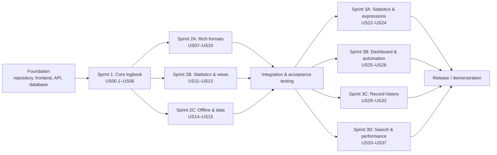
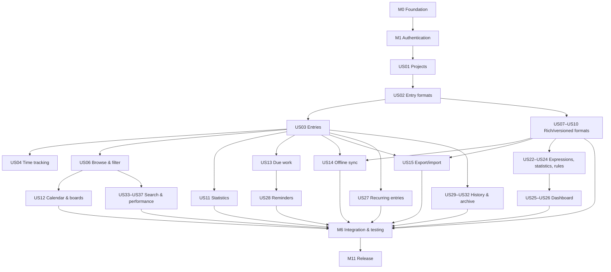

# Digital Logbook Roadmap

## Purpose and scope

This roadmap is the delivery plan for the Digital Logbook. It connects the
product brief to the user stories, team work areas, dependencies, testing and
release activities. A milestone is only complete when its acceptance tests pass
in the integrated application.

The agreed scope contains the Basic user stories (US00.1–US06), the
Intermediate user stories (US07–US15), and the Advanced user stories
(US22–US37). The brief's **Advanced** section gave requirements but no user
stories, so the team wrote the Advanced stories and acceptance tests
themselves at the start of Sprint 3 and tracked them as Gitea issues #94–#109
under the `Sprint 3 - Advanced Logbook` milestone.

## Delivery at a glance

## Milestones and status

| Milestone | Scope | Owner / work area | Status | Completion evidence |
| --- | --- | --- | --- | --- |
| M0 – Foundation | Monorepo, React frontend, Express API, Prisma/Neon database, documentation and build tooling | Whole team | Complete | Apps build and the local development environment runs |
| M1 – Accounts | US00.1–US00.4: register, sign in, reset password, delete account | Whole team | Complete | Authentication acceptance tests pass |
| M2 – Core logbook | US01–US06: projects, formats, entries, time, archiving, browsing/filtering | Whole team | Complete | Core acceptance tests pass |
| M3 – Rich entry formats | US07–US10: rich fields, editable/versioned formats, computed fields | Person 1 | Complete | Rich-field, format-history and computed-field tests pass |
| M4 – Statistics and views | US11–US13: custom-field analysis, calendar/board views, due/unfinished work | Person 2 | Complete | Statistics, view and due-date tests pass |
| M5 – Resilience and portability | US14–US15: offline capture/sync, export/import | Person 3 | Complete | Offline and export/import tests pass |
| M6 – Integration and quality | Cross-feature integration, regression, responsive and usability testing | Person 4 with all members | Complete | Test results, defect fixes and a clean CI build |
| M7 – Statistics and expressions | US22–US24: custom expressions, saved statistics, automation rules | Member 1 | Complete | Expression, statistic and automation tests pass |
| M8 – Dashboard and automation | US25–US28: custom dashboard, persisted layout, recurring entries, reminders | Member 2 | Complete | Dashboard, recurrence, reminder and push tests pass |
| M9 – Record history | US29–US32: version history, view as of a date, restore, archiving | Member 3 | Complete | History, restore and archiving tests pass |
| M10 – Search and performance | US33–US37: query performance, structured, combined and ranked search | Member 4 | Complete | Performance and search tests pass |
| M11 – Release | Deployment check, documentation, final demonstration and submission | Whole team | Planned | All required acceptance tests pass and no critical defects remain |

## Detailed plan

### M0 – Project foundation

**Goal:** establish a reliable technical base before feature work begins.

- Set up the monorepo and shared TypeScript types.
- Configure React/Vite, Express, Prisma and Neon PostgreSQL.
- Define database relationships for users, projects, fields and entries.
- Configure environment variables, local development, builds and API testing.
- Maintain technical documentation, system design and the database ERD.

**Dependency:** none. All later milestones use this foundation.

---

### M1 – Accounts and personal data ownership

**User stories:** US00.1 Create an Account, US00.2 Sign In, US00.3 Reset
Password, US00.4 Delete Account.

**Goal:** ensure every logbook belongs to its authenticated student.

- Registration, validation and duplicate-account protection.
- JWT-protected access to projects and entries.
- Email verification and password reset.
- Account deletion and related data handling.

**Dependency:** M0. Every later milestone requires authenticated ownership checks.

---

### M2 – Basic digital logbook

**User stories:** US01–US06.

**Goal:** replace the paper logbook with a useful, project-based record of
work.

| Capability | User stories | Outcome |
| --- | --- | --- |
| Project management | US01, US05 | Create, describe, edit, archive and recover projects without losing records |
| Per-project entry formats | US02 | Define Text, Number, Date and Boolean fields for each project |
| Fast entry capture and time | US03, US04 | Record work, dates, field values and duration against a project |
| Review and retrieval | US06 | Browse a chronological record, search, sort and narrow entries by project |
| Core feedback | Supports US04/US06 | Dashboard activity, project totals, weekly entries and time summaries |

**Dependency:** M1 for ownership; US01 before US02; US02 before US03; US03
before US04 and US06.

---

### M3 – Rich and durable entry formats

**Owner:** Person 1 – Entry Formats & Fields
**User stories:** US07–US10.

| Story | Capability | Dependency | Status |
| --- | --- | --- | --- |
| US07 | Tags, checklists, links and references | M2 entry formats and entries | Complete |
| US08 | Add, remove and rename fields in an existing format | US02 | Complete |
| US09 | Immutable format history; older entries stay readable | US08 and existing entries | Complete |
| US10 | Computed number fields based on other numeric fields | US02/US03 | Complete |

**Definition of done:** all US07–US10 acceptance tests pass against the
integrated database, including changes to a format after entries already exist.

---

### M4 – Statistics, views and unfinished work

**Owner:** Person 2 – Statistics & Views
**User stories:** US11–US13.

| Story | Capability | Dependency |
| --- | --- | --- |
| US11 | Total, group, compare and plot values from any user-defined field | M2 entry values; M3 typed rich fields where relevant |
| US12 | Calendar and board views; group board entries by a selected field | M2 entry browsing; US11 grouping utilities can be shared |
| US13 | Due dates, unfinished-work view and completed-work handling | M2 entries and dates |

**Definition of done:** US11–US13 pass without modifying or duplicating the
underlying entry records.

---

### M5 – Offline access and portable records

**Owner:** Person 3 – Offline & Data
**User stories:** US14–US15.

| Story | Capability | Dependency |
| --- | --- | --- |
| US14 | Save entries locally while offline and synchronise on reconnection | M2 entry creation; M3 entry-format data must remain compatible |
| US15 | Export a readable backup and import valid data safely | M2 projects, fields and entries; M3 versioned formats where included |

**Definition of done:** no entry is lost across a connectivity interruption,
and an exported logbook can be read and restored successfully.

---

### M6 – Integration, testing and quality

**Owner:** Person 4 – Integration & Testing, with support from all members.

**Goal:** prove that independently developed features work together as one
logbook.

- Apply tracked Prisma migrations to the target Neon database.
- Run backend/API tests, frontend tests, production builds and linting in CI on every push.
- Test every user-story acceptance table in `docs/user-stories/user-stories.md`.
- Test cross-feature flows: rich/versioned formats with offline entries,
  imported data with views/statistics, due dates in all entry views, and
  automation, recurrence and restores writing entry history.
- Test authorisation: one student must not access another student's projects,
  entries, statistics, rules, reminders or exports.
- Test error messages, empty states, responsive layouts and regression cases.
- Record defects, assign an owner, retest fixes and update acceptance status.

**Definition of done:** all required stories are marked Pass, migrations and
deployment configuration are documented, and no known critical defect remains.

---

### M7 – Statistics and expressions

**Owner:** Member 1 – Custom Statistics & Expressions
**User stories:** US22–US24.

| Story | Capability | Dependency | Status |
| --- | --- | --- | --- |
| US22 | Write an expression over your own entries, evaluated safely on the server | M3 custom and computed fields | Complete |
| US23 | Save an expression as a named statistic beside the built-in ones | US22 | Complete |
| US24 | Rules that add or remove tags or set status when an entry is saved | M2 entries; tags | Complete |

---

### M8 – Personal dashboard and automation

**Owner:** Member 2 – Personal Dashboard & Automation
**User stories:** US25–US28.

| Story | Capability | Dependency | Status |
| --- | --- | --- | --- |
| US25 | Choose the statistics and information panels on your dashboard | US23 saved statistics | Complete |
| US26 | Arrange the panels and keep the layout on every device | US25 | Complete |
| US27 | Entries that repeat daily, weekly or monthly | M2 entry creation | Complete |
| US28 | Reminders from due dates, stalled work and daily logging, pushed to devices | US13 due dates | Complete |

---

### M9 – Record history

**Owner:** Member 3 – Versioning & Record History
**User stories:** US29–US32.

| Story | Capability | Dependency | Status |
| --- | --- | --- | --- |
| US29 | Every change to an entry is kept as a version | M2 entries | Complete |
| US30 | See an entry as it was on a given date | US29 | Complete |
| US31 | Restore an earlier version, itself recorded as a new version | US29 | Complete |
| US32 | Archive old entries out of the default views without losing them | M2 entries | Complete |

---

### M10 – Search and performance

**Owner:** Member 4 – Advanced Search & Performance
**User stories:** US33–US37.

| Story | Capability | Dependency | Status |
| --- | --- | --- | --- |
| US33 | Indexes, paginated entry listing and one request for open work | M2 entries | Complete |
| US34 | Apply rules when capturing entries (same story as US24) | US24 | Complete |
| US35 | Rank search results by relevance | US37 | Complete |
| US36 | Combine several search filters | US37 | Complete |
| US37 | Search inside custom fields | M2 browsing; M3 custom fields | Complete |

---

### M11 – Release and demonstration

**Goal:** deliver a stable, documented version of the agreed product.

1. Merge approved feature branches into `main` through pull requests.
2. Apply production migrations through the agreed integration process.
3. Verify production configuration, database connectivity and authentication,
   including the keys for 2FA and push notifications.
4. Run a final demonstration: account → project → format → entry → review →
   statistics/due work → offline/export → dashboard, reminders and history.
5. Finalise architecture, setup, roadmap, user-story and testing documentation.
6. Tag or otherwise identify the submission/release commit.

## Dependency map

## Roadmap completion criteria

The roadmap is complete when:

- Every agreed user story, US00.1–US15 and US22–US37, has passed its
  acceptance tests.
- Frontend, backend, database and migrations work together in the target
  environment.
- The user can safely create, find, retain, export and restore their record of
  work, including any past version of an entry.
- Advanced features do not regress Basic and Intermediate logbook behaviour.
- Documentation, deployment instructions and test evidence are ready for the
  final demonstration or submission.
