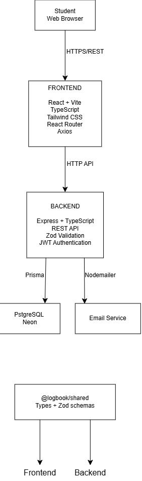
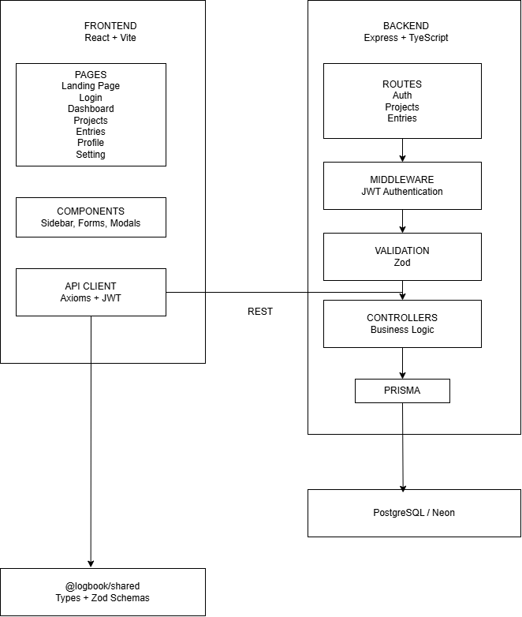

# Initial System Design

> This page records the design as it was planned at the start of the project
> (August 2026). It is kept unchanged as a record of the starting point. The
> system has grown considerably since; §4 summarises how, and
> [System Architecture](../architecture.md) and
> [Database Design](database-erd.md) describe it as built.

## 1. High-Level System Architecture

The Digital Logbook is designed as a non-monolithic web application.
The system separates the user interface from the backend API and
database.

### Architecture Overview

The system consists of the following main components:

- **Frontend:** React, Vite, and TypeScript provide the user interface.
- **Backend:** Express and TypeScript provide the hand-written REST API
  and application logic.
- **Database:** PostgreSQL, hosted using Neon, stores persistent data.
- **Prisma:** Provides database access from the backend.
- **Authentication:** JWT-based authentication protects authenticated
  API requests.
- **Email Service:** Nodemailer supports email verification and
  password-reset functionality.
- **Shared Package:** `@logbook/shared` contains types and validation
  schemas shared between the frontend and backend.

### Communication

The frontend communicates with the backend using HTTP REST requests.
Authenticated requests include a JWT token.

The backend validates incoming requests using Zod before processing
business logic and accessing the database through Prisma.

## 2. Component Architecture

The application is divided into separate frontend and backend components.
This separation allows the frontend and backend to be developed, tested,
and deployed independently.

### Frontend

The frontend is responsible for the user interface, client-side routing,
form interaction, and communication with the backend API.

The main frontend components are:

- **Pages** — Application screens such as Dashboard, Projects, Entries,
  Profile, and Settings.
- **Reusable Components** — Shared interface elements such as the Sidebar,
  forms, modals, and page headers.
- **API Client** — Uses Axios to communicate with the backend REST API.
- **Routing** — React Router manages public and authenticated routes.

### Backend

The backend provides the application's hand-written REST API and contains
the business logic.

The main backend components are:

- **Routes** — Define the HTTP API endpoints.
- **Middleware** — Handles authentication and request processing.
- **Validation** — Zod schemas validate incoming request data.
- **Controllers** — Implement application business logic.
- **Utils** — Provide supporting functionality such as password hashing
  and email delivery.
- **Prisma** — Provides access to the PostgreSQL database.

### Shared Package

The `@logbook/shared` package contains common TypeScript types and Zod
schemas used by both the frontend and backend. This reduces duplication
and keeps the data structures used across the application consistent.

## 3. Database Design

The Digital Logbook uses PostgreSQL as its persistent data store. Prisma ORM
provides access to the database from the Express backend.

### Main Entities

| Entity | Purpose |
|---|---|
| User | Stores student account information |
| Project | Stores projects belonging to a student |
| EntryField | Defines the custom fields available for a project |
| LogbookEntry | Stores individual logbook entries |
| EntryValue | Stores the value of a custom field for an entry |
| PasswordReset | Stores password-reset information |

### Key Relationships

- A user can own multiple projects.
- A project can contain multiple entry fields and logbook entries.
- An entry contains values corresponding to the fields defined by its project.
- Password-reset records are associated with the user who requested the reset.

### Data Integrity

Foreign keys are used to maintain relationships between entities.
Unique constraints prevent duplicate values where required, and cascading
deletes support account deletion and associated data removal.

## 4. How the Design Has Evolved

The initial design held up: the system is still a React frontend, an Express
REST API and a PostgreSQL database, with a shared types package, and the
EAV entry model above still carries every project's custom fields. What
changed is what was built on top of it.

| Area | Initial design | Now |
|---|---|---|
| Database | 6 tables | 20 tables: format versions, entry versions, tags, custom statistics, dashboard layouts, automation and recurrence rules, reminders, push subscriptions, recovery codes and the Google Calendar connection were added |
| Field types | Text, Number, Date, Boolean | Also Tags, Checklist, Link, Reference and Computed |
| Entry history | An entry is overwritten when edited | Every change is kept as a version and can be viewed or restored |
| Authentication | JWT sign-in, email verification, password reset | Also TOTP two-factor authentication with recovery codes, encrypted secrets, hashed tokens and rate limiting |
| Email | Nodemailer (Gmail SMTP) | Resend, with Gmail SMTP as a fallback |
| Background work | None | Jobs in the API process create recurring entries, push due reminders and purge deleted accounts |
| Frontend | Pages, components, API client, routing | Also a service worker for offline use and push notifications, and an offline entry queue |
| Integrations | None | Google Calendar sync and web push |
| Deployment | Not yet decided | Frontend on Cloudflare Pages, backend on Render, database on Neon, CI on Gitea Actions |

The request pipeline also gained an explicit ownership check: a valid token
proves who the caller is, and every query is then scoped to that user's own
data. See [Architecture Design](architecture.md) for the pipeline and sign-in
flow.