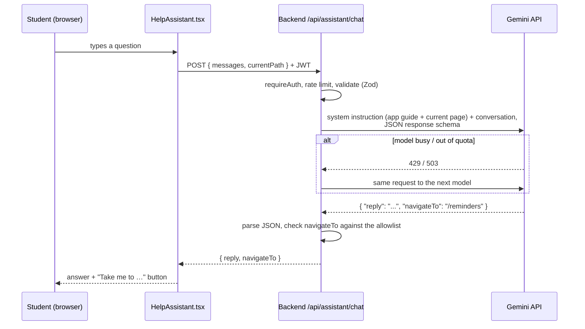

# AI Help Assistant

## 1. Overview

A floating **"Ask for help"** chat button appears on every signed-in page. A
student types a question about using the app ("How do I make an entry
repeat?") and gets a short answer generated by Google's **Gemini** API. When
one page of the app answers the question, the reply comes with a
**"Take me to …"** button that navigates there.

The assistant only answers questions about Digital Logbook, and it never sees
the student's logbook data.

## 2. Problem / Motivation

The app has grown to many pages: projects, entries, open work, stats,
calendar, board, reminders, My Grades, profile and settings, each with several
tools. In Round 1 user testing, one of six testers struggled to find the
Calendar and Board views (tracked as `FEAT-003`, view discoverability). A
student who cannot find a feature effectively does not have it.

The commit that introduced the assistant describes its purpose as helping
students "find their way around the app": instead of searching the sidebar,
they can ask in their own words and be taken to the right page. (`FEAT-003`
itself, which proposes navigation hints and a guided tour, remains a separate
open issue.)

## 3. What It Does

- A round button in the corner of every signed-in page opens a chat panel.
- The panel offers four suggested questions to start with, for example
  "Where do I set up reminders?".
- The student's question, together with the earlier turns of the
  conversation, is answered in two to five sentences or a few steps, naming
  the exact page and button to use.
- If the answer is a page, a **"Take me to Reminders"** (or similar) button
  appears under the reply. It is hidden when the student is already on that
  page.
- Off-topic questions are politely declined.
- If the assistant is not configured, busy or rate-limited, the panel shows
  the server's explanation and puts the question back in the text box, so it
  can be sent again without being sent twice.
- Enter sends; Shift+Enter adds a new line; Escape closes the panel.
- The conversation lasts until the page is reloaded; it is not stored.

## 4. How It Works

1. **Browser.** `HelpAssistant.tsx` sends the whole conversation so far plus
   the current route (`location.pathname`) to `POST /api/assistant/chat`
   through the shared Axios client, which attaches the student's JWT.
2. **Backend checks.** The route requires a signed-in student
   (`requireAuth`), applies a dedicated rate limit, and validates the body
   with Zod before anything is sent to Google.
3. **Prompt.** The backend builds a Gemini request: a fixed *system
   instruction* describing the app, plus the student's current page, plus the
   conversation.
4. **Structured output.** Gemini is asked to reply in a fixed JSON shape: an
   answer, and at most one page from a fixed list.
5. **Validation and fallback.** The backend parses the JSON, discards any page
   that is not a real route, and, if a model is busy, retries with the next
   configured model.
6. **Display.** The frontend shows the reply and, when there is a page, a
   button that calls React Router's `navigate()`.

## 5. Technical Implementation

| Layer | File | Responsibility |
|---|---|---|
| UI | `apps/frontend/src/components/HelpAssistant.tsx` | Floating button, chat panel, suggested questions, "Take me to" button, error display |
| UI mount | `apps/frontend/src/components/AppLayout.tsx` | Renders the assistant once inside the signed-in layout, so it is on every app page |
| API client | `apps/frontend/src/api.ts` (`askAssistant`) | `POST /assistant/chat` |
| Route | `apps/backend/src/routes/assistant.routes.ts` | `POST /api/assistant/chat` behind `requireAuth` and `assistantLimiter` |
| Controller | `apps/backend/src/controllers/assistant.controller.ts` | 503 when unconfigured, 400 on invalid input, 502 when no model answers |
| Validation | `apps/backend/src/schemas/assistant.schema.ts` | Conversation shape and size limits |
| AI logic | `apps/backend/src/utils/assistant.ts` | App guide, request building, Gemini calls, model fallback, response parsing |
| Rate limit | `apps/backend/src/middleware/rateLimit.middleware.ts` (`assistantLimiter`) | Questions per window per IP address |
| Tests | `apps/backend/src/__tests__/assistant.test.ts`, `apps/frontend/src/components/__tests__/HelpAssistant.test.tsx` | Gemini is mocked; no real API calls in tests |

No database tables are involved, and no new npm dependency: the backend calls
Gemini's REST endpoint with Node's built-in `fetch`.

### AI-specific details

**Provider and endpoint.** Google's Gemini API, called over REST at
`https://generativelanguage.googleapis.com/v1beta/models/<model>:generateContent`.
The API key is sent in the `x-goog-api-key` header from the backend only; the
browser never sees it.

**Model(s).** By default the backend tries `gemini-flash-lite-latest`, then
`gemini-3.1-flash-lite`. The list can be replaced with the `GEMINI_MODEL`
environment variable (comma-separated, tried in order).

**Why this provider and these models.** The code and configuration record
that the free tier is enough for this use (`apps/backend/.env.example`), and
that the "lite" models are the ones a free-tier key can use reliably
(`apps/backend/src/utils/assistant.ts`). Gemini also supports a JSON
*response schema*, which the "Take me to" button depends on (see below). A
comparison with other providers is not recorded in the repository.

**What is sent to the AI.** Only:

- the conversation in the chat panel (the student's questions and the
  assistant's earlier answers), at most the last 20 messages, each at most
  1,000 characters;
- the route the student is currently on, e.g. `/reminders`;
- the fixed app guide (below).

No logbook data (projects, entries, grades), no name, email or account id is
sent. The code records why: the free Gemini tier may use prompts to improve
Google's models.

**How the prompt is constructed.** `buildRequest()` in `assistant.ts` sends:

- `systemInstruction`: the constant `APP_GUIDE` text plus
  "The student is currently on `<path>`." `APP_GUIDE` tells the model its role,
  to be brief, to name exact pages and buttons, to answer only about this app,
  and never to invent features. It then describes every page and its controls.
  Because it is written by hand, it must be updated whenever a feature is
  added (it was, for example, extended for My Grades).
- `contents`: the conversation, each message tagged `user` or `model`.
- `generationConfig`: `temperature: 0.3` (consistent, factual answers),
  `maxOutputTokens: 600`, `responseMimeType: "application/json"` and a
  `responseSchema` requiring `reply` (a string) and `navigateTo` (one of
  `"none"` or the allowed app routes).

**How the response is processed.** `parseModelOutput()`:

- parses the JSON; if the model ignored the format, the raw text is still used
  as the answer;
- keeps `navigateTo` only if it is in `NAVIGABLE_PATHS`, the list of real
  routes, so the model can never send a student to a page that does not
  exist;
- treats an empty answer as a failure, so the next model is tried.

**Error and fallback behaviour.**

| Situation | Behaviour |
|---|---|
| `GEMINI_API_KEY` not set | `503` "The help assistant is not set up on this server." |
| Invalid conversation (empty, too long, not ending with a question) | `400` with the reason |
| Too many questions from one address | `429` from the rate limiter (default 30 per 10 minutes, configurable) |
| A model answers 404, 429, 500 or 503, or returns nothing | The next model is tried |
| Any other error, or every model failed | `502` "The assistant couldn't answer right now…" |
| A model takes more than 20 seconds | The request is aborted and treated as a failure |

In every error case the frontend shows the message and keeps the typed
question.

**Security and privacy.**

- The API key lives only in the backend environment (`GEMINI_API_KEY`); the
  frontend talks to our backend, never to Google directly.
- Only signed-in students can use the endpoint, and it is rate-limited to
  protect the shared free-tier quota.
- No personal or logbook data is sent (see above).
- The model's output cannot cause navigation outside the allowlisted routes.
- Input size is capped (20 messages × 1,000 characters).

**Example interaction.** The exchange below shows the format; the exact wording
of a live answer comes from the model and varies.

> **Student:** Where do I set up reminders?
>
> **Assistant:** Open Reminders and press New reminder. Your reminder rules,
> such as how many days before a due date to remind you, are on the same page.
>
> **[Take me to Reminders]**

The backend receives `{"reply": "...", "navigateTo": "/reminders"}` from
Gemini and returns the same shape to the browser.

## 6. User Workflow / Demonstration

1. Sign in; any app page shows the round help button in the corner.
2. Click it. The panel opens with suggested questions.
3. Click "Where do I set up reminders?" or type a question.
4. Read the answer; click **Take me to Reminders**. On a computer the panel
   stays open on the new page; on a phone-sized screen it closes so the page
   is visible. The conversation is kept either way.
5. Ask a follow-up ("And how do I turn on notifications?"); the earlier turns
   are sent too, so the assistant understands "and".
6. Ask something unrelated ("What's the capital of France?") to see it decline.

## 7. Screenshots

Add these files under `docs/extra-features/images/ai-help-assistant/`, then
remove the comment markers around each image.

| File | Should show |
|---|---|
| `chat-closed.png` | An app page with the help button in the corner |
| `chat-suggestions.png` | The open panel with the suggested questions |
| `chat-answer.png` | An answer with its "Take me to …" button |
| `chat-error.png` | The message shown when the assistant is unavailable |

<!--  -->
<!--  -->
<!--  -->
<!--  -->

## 8. Limitations

- **Accuracy depends on the hand-written app guide.** A feature missing from
  `APP_GUIDE` is unknown to the assistant, and the model may still phrase an
  answer imperfectly.
- **Two lists to keep in step.** The pages the assistant may point to
  (`NAVIGABLE_PATHS` in the backend) and the names on its buttons
  (`PAGE_NAMES` in `HelpAssistant.tsx`) are separate lists. A page added to
  the first but not the second shows its path, such as "/grades", instead of
  its name.
- **Free-tier limits.** Shared quota can run out; the fallback model helps but
  cannot guarantee an answer. Free-tier prompts may be used by Google to
  improve its models, which is why no logbook data is sent.
- **The rate limit is per IP address,** so students behind one network
  address share it.
- **No memory between visits.** The conversation is lost on reload.
- **Answers are not streamed;** the student waits for the whole reply.
- **Help only.** It cannot perform actions or read the student's own data, so
  it cannot answer "what is due tomorrow?".

## 9. Future Improvements

- Share one list of pages between the backend allowlist and the frontend's
  button names, so they cannot drift apart.
- Generate parts of `APP_GUIDE` from the route list, so new pages cannot be
  forgotten.
- Stream answers for a faster feel.
- With explicit consent and a paid tier that does not train on prompts, allow
  questions about the student's own data.
- Add the guided tour proposed in `FEAT-003` alongside the assistant.

## 10. Contributors

From the commit history:

- **WendyAmahle**: designed and implemented the assistant (commit `8209119`,
  "add a Gemini help assistant for finding your way around the app").
- **Dineo**: extended the app guide for My Grades and assessment reminders.

The team should confirm this list.
