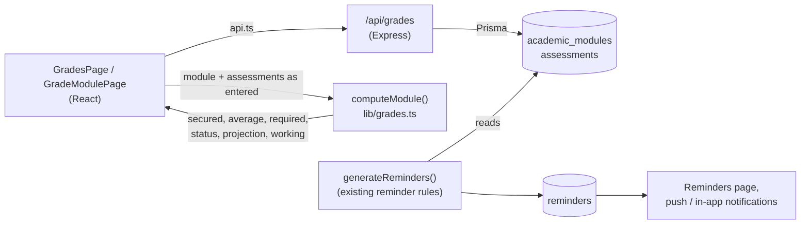

# My Grades

## 1. Overview

**My Grades** lets a student track their university modules and the
assessments that make up each mark. For every module it shows how many marks
are already **secured**, the student's **average on marked work**, how much of
the module is **marked** and **remaining**, the mark needed on the rest to
reach a **target**, whether that target is still reachable, and a
**what-if** calculator. Assessments can carry a due or test date, which feeds
an upcoming list and reminders 5 days and 2 days before.

It is reached from **My Grades** in the sidebar (`/grades`).

## 2. Problem / Motivation

In SUS Round 2 the one substantive "one change" suggestion was a
*"year to date calculator or tracking of grades"*
(`docs/project/feedback/user-feedback.md`; tracked as `FEAT-009`). Students already work out
these figures by hand or in spreadsheets, and the common mistakes are exactly
the ones the app can prevent:

- mixing up a mark out of a maximum (25 / 40) with a percentage (62.5%);
- confusing **points secured** (45 out of 100) with **performance so far**
  (75% on the 60% that has been marked). A student on 45 points with 60%
  marked is doing well, not failing;
- full-year modules, where each semester's assessments total 100% *within the
  semester*, and the semesters are then weighted (60/40, 50/50 …) into the
  module. That is two separate levels of weighting.

## 3. What It Does

**Overview page (`/grades`)**

- An **Upcoming** strip of dated, unmarked assessments in the next 14 days,
  with countdowns ("In 3 days · Test").
- An **Academic year** dropdown built from the years the student actually has
  modules in, plus **All years**. Nothing is hard-coded: a new year appears
  as soon as a module exists for it.
- **All / Semester 1 / Semester 2** filters; full-year modules appear under
  both semesters.
- A card per module: Secured `X / 100`, Average on marked work, a marked /
  remaining bar, and the target status, or **Finish setting up** while the
  weights do not add up.

**Module page (`/grades/:moduleId`)**

- Four tiles: **Secured**, **Average on marked work**, **Marked**,
  **Remaining**. There is deliberately no ambiguous "current mark".
- The assessments: weight, the mark exactly as entered with its conversion
  (`25 / 40 = 62.5%`), its contribution in points (`25.0 pts`), a status badge
  (Marked, Missed, Not marked yet, Awaiting mark), and its date. Full-year
  modules are grouped by semester, with each semester's weight, mark and
  points.
- Weight checks: "Weights total 90% — 10% unassigned". An incomplete setup can
  be saved, but **What do I need?** and **What if?** stay off until it is
  fixed, so they never calculate on wrong weights.
- **What do I need?**: choose a target (Pass 50%, 60%, 70%, 75% or custom) to
  see the average needed on the remaining work, rounded *up*, with the
  assumption stated, plus the highest possible final mark and a status:
  *Secured, Within reach, Stretch, Not reachable, Not enough data* or
  *No target*.
- **What if?**: a slider ("If I average 60% on everything left") or a mark per
  remaining assessment, giving a projected final mark. It is labelled
  **Hypothetical — not saved**, and with one assessment left it shows a table
  (40% → 61%, 50% → 65% …).
- **How is this calculated?**: the working, line by line, with the student's
  own numbers.
- Add, edit and delete modules and assessments. Deleting a module asks for
  confirmation and removes its assessments too.

**Reminders.** A dated assessment produces a reminder 5 days before and
another 2 days before, on the existing Reminders page and as notifications
when those are switched on. They can be turned off per assessment, or for all
assessments with the "Upcoming tests & assessments" rule.

## 4. How It Works

1. The API stores and returns **only what the student entered**: weights, the
   mark as `25 / 40` or `62.5%`, missed, dates. It calculates nothing.
2. In the browser, every figure comes from **one pure function**,
   `computeModule(module, { target, hypothetical })`. The cards, tiles, target
   panel, what-if projection and explanation all read its result, so they can
   never disagree, and the UI contains no grade arithmetic of its own.
3. What-if calls the same function with hypothetical marks filled in for
   unmarked assessments. Real marks are never overridden and nothing is saved.
4. Reminders are produced by the app's **existing** reminder generator, which
   gained one rule; there is no second notification system.

## 5. Technical Implementation

### The calculation engine: `apps/frontend/src/lib/grades.ts`

Pure TypeScript: no React, no network, no dates. Problems are reported as
`setup.issues`, never thrown.

- **Two weighting levels.** An assessment's `weight` is its share of its
  *section*. A semester module has one section worth 100; a full-year module
  has Semester 1 and Semester 2, where only Semester 1's weight is stored and
  Semester 2 is `100 − S1`, so they always total 100 and there is no 50/50
  default. Each assessment's **effective weight** is the product of the two
  (40% of a Semester 1 worth 60% is 24% of the module).
- **Core formulas**, all on effective weights:
  `contribution = percent × effectiveWeight / 100`;
  `secured = Σ contributions` (missed counts as 0);
  `average = secured / markedWeight × 100`;
  `required = (target − secured) / remainingWeight × 100`;
  `highest possible = secured + remainingWeight`.
- **Target status**, first match wins: Secured (secured ≥ target) → Not
  reachable (required > 100, or nothing left) → Not enough data (nothing
  marked) → Within reach (required ≤ average) → Stretch. A required mark is
  only reported when it is achievable, so the UI never shows a negative or
  above-100 requirement.
- **Setup rules.** A section's weights must total 100 (within 0.01, so 33.33 ×
  3 counts); a section with **no** assessments yet counts as fully remaining,
  so targets work during Semester 1 before Semester 2 is set up. Weights are
  never silently normalised.
- **Rounding** happens only in the engine's display helpers: one decimal
  place, the required mark rounded up, and a small tolerance for floating-point
  noise (`100 − 99.99` is `0.0100000000000051` in JavaScript).
- **Explanation data** (`summary.explanation`): the "How is this calculated?"
  panel renders these lines instead of recomputing anything.

### Frontend

| File | Responsibility |
|---|---|
| `apps/frontend/src/pages/GradesPage.tsx` | Overview, year and semester filters, upcoming strip |
| `apps/frontend/src/pages/GradeModulePage.tsx` | Module page, assessment tables, delete flows |
| `apps/frontend/src/components/grades/` | `ModuleCard`, `ModuleFormModal`, `AssessmentFormModal`, `TargetPanel`, `WhatIfPanel`, `CalculationExplainer`, `UpcomingAssessments`, `GradeBadges` |
| `apps/frontend/src/lib/gradeDisplay.ts` | Labels, calendar-day countdowns, the upcoming list, year options. No grade arithmetic |
| `apps/frontend/src/api.ts` | `fetchGradeModules`, `createAssessment`, …; reads are cached for offline viewing |

### Backend

| File | Responsibility |
|---|---|
| `apps/backend/src/routes/grades.routes.ts` | Mounted at `/api/grades`; `router.use(requireAuth)` and `router.param` ownership loaders |
| `apps/backend/src/controllers/grades.controller.ts` | CRUD, module type changes, response shaping |
| `apps/backend/src/schemas/grades.schema.ts` | Zod field rules and how fields fit together (one way of entering a mark, date ⇔ date kind, section ⇔ module type) |
| `apps/backend/src/utils/reminders.ts` | The assessment reminder rule inside the existing `generateReminders` |

**API** (`docs/api/reference.md`, "My Grades"):
`GET`/`POST /api/grades/modules`, `GET`/`PATCH`/`DELETE /api/grades/modules/:moduleId`,
`POST /api/grades/modules/:moduleId/assessments`,
`PATCH`/`DELETE /api/grades/assessments/:assessmentId`.

**Ownership** was designed so it cannot be forgotten (an earlier project bug,
BUG-011, was a missing ownership check): every route needs a signed-in student,
and any route naming `:moduleId` or `:assessmentId` goes through a loader that
only finds the caller's own record, returning `404` otherwise. A test walks
the router's route list, so a newly added route is checked automatically.

### Database (Prisma / PostgreSQL)

- Migration `20261005200000_my_grades`: enums `ModuleType` and
  `AssessmentDateKind`; tables `academic_modules` (unique per student, code
  and academic year, so a repeated module in a later year is allowed) and
  `assessments`. Marks are `DECIMAL` and stored as entered; the date is a
  `DATE` with no time, so no time zone can move a test to the previous day.
  Both tables cascade-delete with their owner.
- Migration `20261006090000_assessment_reminders`: reminder source
  `ASSESSMENT`, `reminders.assessment_id` (cascade), `assessments.remind`, and
  `reminder_settings.assessment_enabled`.

### Reminders (inside the existing pipeline)

- **When:** for each unmarked, not-missed assessment with `remind` on and a
  date within 5 days. The 5-day reminder covers 5 to 3 days before; the 2-day
  reminder covers 2 days before to the day itself.
- **Keys:** each reminder has a stable key, `assessment:<id>:<date>:<5|2>`.
  Together with the existing unique `(user, ruleKey)` index this means
  re-running the rules never duplicates a reminder, and each is pushed once.
- **Titles** name the date rather than counting down: "Test on Sun 15 Nov:
  COMS3011A Final Test", "Due Fri 13 Nov: …".
- **Timing:** new reminders appear from 08:00 in the student's time zone, so
  no notification arrives overnight.
- **Cleanup** uses the generator's existing rules. A marked or missed
  assessment completes its reminder. A moved or passed date, or a switched-off
  rule, removes it. Deleting the assessment deletes it.

### Tests

| Area | Test files |
|---|---|
| Engine | `apps/frontend/src/lib/__tests__/grades.test.ts`: worked examples, every edge case, property checks over 400 random modules |
| Pages | `GradesPage.test.tsx`, `GradeModulePage.test.tsx`, `gradeDisplay.test.ts` |
| API | `grades.test.ts` (database) and `gradesValidation.test.ts` (no database) |
| Reminders | `assessmentReminders.test.ts` (database, fixed dates) and `assessmentReminderRules.test.ts` |

## 6. User Workflow / Demonstration

1. Open **My Grades** from the sidebar and press **Add module**: code
   `COMS3011A`, name, academic year, **Semester module**, Semester 2.
2. Add assessments: *Midterm*, weight 40, **Mark out of** 25 / 40 (the form
   shows "Recorded as 25 / 40 = 62.5%"); *Tutorial 1*, 10, 10 / 10;
   *Tutorial 2*, 10, 100%; *Exam*, 40, no mark, with a date and **Test or exam
   date**.
3. The tiles read **Secured 45.0 / 100**, **Average 75.0%**, **Marked 60.0%**,
   **Remaining 40.0%**.
4. In **What do I need?** choose **Pass (50%)**: "You need 12.5% on the
   remaining 40% to finish with 50%", status *Within reach*.
5. In **What if?** drag to 60%: projected final mark **69.0%**, labelled
   hypothetical. The table lists 40% → 61.0% … 80% → 77.0%.
6. Open **How is this calculated?** to see each line of the working.
7. Add a full-year module with **S1 60 / S2 40** to see the two weighting
   levels: a Semester 1 test at 40% shows "24% of module".
8. Back on the overview, the exam appears in **Upcoming**; 5 days before it, a
   reminder appears on the **Reminders** page.

## 7. Screenshots

Add these files under `docs/extra-features/images/my-grades/`, then remove the
comment markers around each image.

| File | Should show |
|---|---|
| `overview.png` | Overview with module cards, year dropdown and Upcoming strip |
| `module-page.png` | A module page: tiles, assessment table, target panel |
| `full-year.png` | A full-year module grouped into Semester 1 and Semester 2 |
| `what-if.png` | The What-if panel with its "Hypothetical — not saved" label |
| `explanation.png` | "How is this calculated?" expanded |
| `add-assessment.png` | The assessment form showing "Recorded as 25 / 40 = 62.5%" |
| `reminder.png` | An assessment reminder on the Reminders page |

<!--  -->
<!--  -->
<!--  -->
<!--  -->
<!--  -->
<!--  -->
<!--  -->

## 8. Limitations

- **Unofficial estimate.** University rules such as exam subminimums, DP
  requirements, "best N of M" tutorials, excused assessments, bonus marks and
  supplementary exams are not modelled; the pages say so.
- **The required mark assumes the same mark on every remaining assessment;**
  the UI states this next to the figure.
- **Changes need a connection.** Grades can be viewed offline from the cache
  but not edited offline.
- **Not in export/import yet,** so restoring a backup does not include grades.
- **No GPA or year average;** the correct Wits rules would need to be confirmed
  first.
- **Live-site deployment:** the reminder type `ASSESSMENT` requires the backend
  that includes this feature. An older deployed backend should not run
  against a database that holds such reminders.

## 9. Future Improvements

- A "What needs attention?" summary across modules. (The dashboard already
  shows **Modules at a glance** for the current year, built on the engine's
  statuses.)
- Performance trends per module from real, dated marks only (never what-if
  values).
- Grades in export/import.
- Optional modelling of subminimums and DP rules.
- Optionally linking a module to related logbook projects.

## 10. Contributors

From the commit history:

- **Dineo**: design and implementation in four phases: calculation engine
  (`638ed8e`), API and database (`0dea059`), pages (`7e26597`), assessment
  reminders (`59c9797`, `641f167`).

The team should confirm this list.
